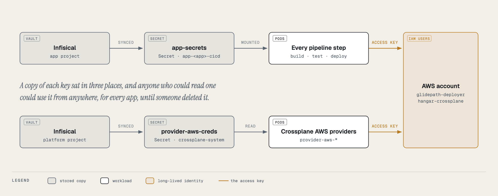
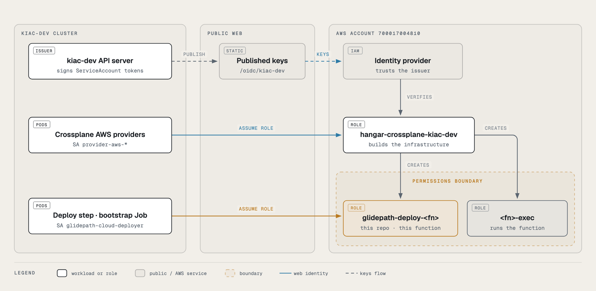
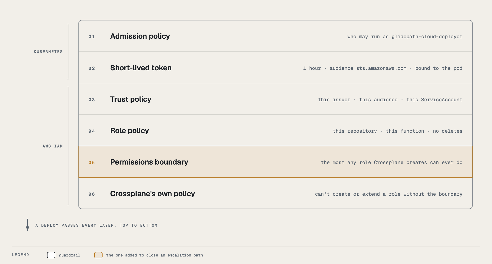
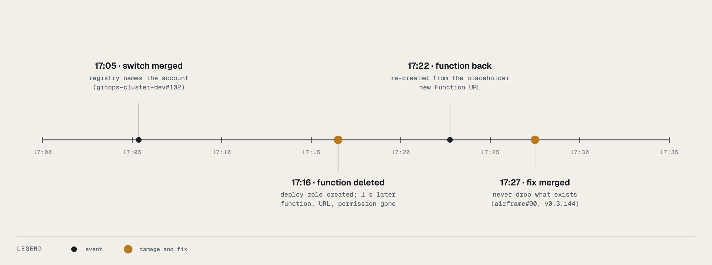

# Cloud credentials: four identities, what each one can reach

Two clouds, two jobs each. **Airframe** (Crossplane, this catalog) builds and tears down the
infrastructure a cloud deploy needs: the `AwsLambdaTarget`, `AwsEcsTarget` and `AzureContainerAppTarget`
compositions in [cloud-targets.md](../user/cloud-targets.md). **Glidepath** (the pipelines) ships images
into it. Each job runs as its own identity with its own key, its own permissions and its own blast
radius, and the two are never shared. On AWS both are IAM roles reached through web identity federation
(since 2026-10-16), so nothing is stored: Crossplane assumes one role, and each Lambda function's or ECS
service's deploy step assumes a role made for that function or service alone. Both Azure identities still use
stored keys until their own migration. [How keyless AWS access works](#how-keyless-aws-access-works) is the place to start.

| | Airframe: the Crossplane provider identity | Glidepath: the deployer identity |
|---|---|---|
| **Who holds it** | The AWS or Azure provider pods in `crossplane-system`, through the provider's `ClusterProviderConfig` | AWS Lambda and ECS: only the `deploy-aws-lambda` / `deploy-aws-ecs` steps and the Lambda target's bootstrap Job, as ServiceAccount `glidepath-cloud-deployer` in the app's `app-<app>-cicd` namespace. Azure: every pipeline TaskRun of the app, through `app-secrets` |
| **What it may do** | Create, observe and delete the resources the three compositions describe: repositories, execution roles, functions and URLs, clusters, task definitions, services, a small VPC; resource groups, environments, container apps | Push an image and roll the deploy surface that image belongs to: `UpdateFunctionCode`, a new task-definition revision plus `UpdateService`, `az containerapp update` |
| **What it must never do** | Deploy code: no `UpdateFunctionCode`, no `UpdateFunctionConfiguration`, no `ecs:UpdateService`. Grant itself more: only the two managed policies the compositions attach, only on `*-exec` roles. Leave its region. | Create or delete anything. Change a function's role, memory or configuration. Touch IAM beyond passing an `*-ecs-exec` role to ECS. Leave its region. |
| **Why the split** | A composition bug or a wrong management policy can only create, observe or delete; it can never roll a function back to the placeholder | Anyone who can merge to the app's repository can run code in its pipeline namespace; that trust boundary must not reach infrastructure or IAM |
| **Where the secret lives** | AWS: nowhere; a projected ServiceAccount token is exchanged with STS for an hour-long session. Azure: Infisical project `platform-cicd-kind-dev`, environment `shared`, path `/`, key `provider-azure-creds` | AWS Lambda: nowhere; the deploy step exchanges a projected token for an hour-long session as `glidepath-deploy-<functionName>`. ECS and Azure (and Lambda, as a fallback until phase 4): the app's own Infisical project `<app>-<devCluster>`, environment `shared`, keys `aws-access-key-id` + `aws-secret-access-key` or `azure-client-id` + `azure-client-secret` + `azure-tenant-id` |
| **How it reaches the cluster** | AWS: the kubelet projects a token (audience `sts.amazonaws.com`) into the provider pods → `ClusterProviderConfig default` (`source: WebIdentity`) → `AssumeRoleWithWebIdentity`. Azure: `platform-secret-store` (ClusterSecretStore) → ExternalSecret `provider-azure-creds` → Secret of the same name, key `credentials`, in `crossplane-system` → `ClusterProviderConfig default` | The app's own ClusterSecretStore → the `app-secrets` ExternalSecret that `airframe-application` renders from the app's `cicd.yaml` `secrets:` list → Secret `app-secrets` in `app-<app>-cicd` |
| **Who can read the Kubernetes Secret** | AWS: there is no Secret. Anyone who can mint a token for a `provider-aws-*` ServiceAccount in `crossplane-system` (cluster admins) can become the role. Azure: cluster admins, Argo CD's application controller, External Secrets, the provider pods. No tenant namespace, not Tower's read identity | Cluster admins, Argo CD, External Secrets, and every pod that runs in that app's cicd namespace: the deploy TaskRuns and, for a Lambda target, the composition's bootstrap Job |

The names below (`hangar-crossplane`, `glidepath-deployer`) are conventions: the cluster only
cares about the role ARN, the Infisical keys and the Secret names in the last two rows. Keep the names anyway; the
cloud's audit log (CloudTrail, the Azure Activity Log) is the only place the two jobs are told apart.

The AWS identities have no long-lived credential. Both Azure identities are still keys;
[Hardening](#hardening-next) says what replaces them.

## How keyless AWS access works

Start here if you are new to this. The short version: nothing in Hangar keeps an AWS password any more. A pod that
needs AWS proves who it is with a token the cluster signed for it, AWS checks that proof, and hands back credentials
that expire in an hour and work for one role only.

### Why it was built

Both AWS identities used to be IAM users with access keys: long-lived passwords for machines, stored in Infisical
and copied into Kubernetes Secrets. A key works from anywhere until someone deletes it, and the deploy key was
shared by every app, so a leak from one app's pipeline reached every app's functions. Rotating keys only shortens
that window; federation removes it.



### How a token becomes AWS access

Every pod has a Kubernetes **ServiceAccount**, and Kubernetes can write a short-lived signed **token** for it into
the pod. kiac-dev signs tokens as `https://hangarplatform.dev/oidc/kiac-dev` and publishes its public keys there
(hangar `web/public/oidc/`), so AWS can check a signature without being able to forge one. An **IAM identity
provider** tells AWS to trust that issuer, and each **IAM role** says in its **trust policy** exactly which
ServiceAccount, with which audience, may assume it.




| Who | Runs as | Assumes | Can do |
|---|---|---|---|
| Crossplane AWS providers | `provider-aws-*` in `crossplane-system` | `hangar-crossplane-<cluster>` | create, observe and delete what the compositions describe |
| Glidepath `deploy-aws-lambda` step | `glidepath-cloud-deployer` in `app-<app>-cicd` | `glidepath-deploy-<functionName>` | push to this function's repository, update this function's code |
| `AwsLambdaTarget` bootstrap Job | `glidepath-cloud-deployer` in `app-<app>-cicd` | `glidepath-deploy-<functionName>` | the same, once, to seed the placeholder image |
| every other pipeline step | `pipeline-runner` | nothing | no AWS access |

### Why it is built this way

- **One deploy role per function, created by the target.** The `AwsLambdaTarget` already creates the function, its
  repository and its execution role, so it creates the deploy role beside them and deletes it with them. A new app
  needs no IAM step, and one app's pipeline can't touch another app's function.
- **A dedicated ServiceAccount.** Pipeline steps run as `pipeline-runner`, including steps that run the app's own
  code. Only the deploy step and the bootstrap Job run as `glidepath-cloud-deployer`, the one subject the deploy
  role trusts.
- **The account is stated once,** in the fleet's `clusters.yaml` (`aws:`). The cluster registry carries it to the
  compositions, and Glidepath's control plane carries it to every app as the ConfigMap `glidepath-cloud-identity`.
  Apps don't repeat it in `cicd.yaml`.
- **A permissions boundary on every role Crossplane creates.** Creating roles is the most dangerous thing the
  Crossplane identity does, so it may only create roles that carry `HangarCloudTargetBoundary` (below).

### The guardrails



Layer 01 lives in gitops-cluster-dev (`30-policy/kyverno-policies/glidepath-cloud-deployer.yaml`). It decides who
may run as `glidepath-cloud-deployer` by **who created the object**, not by labels, which a pipeline run can copy
onto its pods: pods only from Tekton's controller or the Job controller, TaskRuns only from Tekton, Jobs only from
Crossplane, and a PipelineRun may give the ServiceAccount only to the catalog `deploy` Pipeline's
`deploy-aws-lambda` task, with no pod-template `env` (a `BASH_ENV` alone would run code inside the deploy step).

The deploy side (the ServiceAccount and how the step gets its access) is documented in Glidepath's
`docs/admin/cloud-deploy-identity.md`.

### A rule for composition authors: never gate what already exists

Crossplane deletes anything a composition stops rendering. On 2026-10-16 the federation switch made the
`AwsLambdaTarget` bootstrap Job wait for the new deploy role; for one reconcile the role didn't exist, the finished
Job dropped out and was deleted, and on the next reconcile the function, which rendered only after a succeeded Job,
was deleted with its URL and permission. It came back six minutes later from the placeholder image, with a new
Function URL. v0.3.144 (#90) keeps every resource that already exists in the desired state, and the
`switch-keeps-existing` and `job-gone-keeps-function` render cases hold that.



When you add a condition to a composition, ask whether it decides **creation** or **presence**. Only the first is
safe to gate.

The same afternoon showed the rule covers inputs as well as conditions. v0.3.144 still rendered an existing Job only
while the Repository's observed URL was present, and for one reconcile it wasn't (an etcd stall on kiac-dev):
both targets' finished Jobs were deleted and re-run, twice. Nothing broke, because the function no longer hangs on
the Job, but a composition that needs an observed value to *render* something that already exists must recover it
(the Job's own copy destination, here) or render it anyway: a wrong spec is an apply error, a missing one is a
deletion. v0.3.145 does both; the `repository-url-missing-keeps-job` render case holds it. One more detail: a Job
that Crossplane deletes is deleted with orphan propagation (the API default for Jobs), so the garbage collector must
be able to remove its `orphan` finalizer; an admission policy on Job updates has to allow that.

v0.3.147 applies the same rule to the rest of the target's identity. The Job's role ARN comes back from its own spec
if the deploy role is observed without one (`deploy-role-arn-missing-keeps-job`). If the cluster registry can't be
read for a reconcile, the deploy role is re-declared from its own observed spec instead of being dropped (which would
delete it in AWS), and the execution role keeps its permissions boundary (`registry-unreadable-keeps-everything`).

### No access-key mode

Until v0.3.147 an `AwsLambdaTarget` on a cluster without web identity could bootstrap with an access key from
`spec.credentialsSecret`. That field and mode are gone: since phase 4 Glidepath deploys a Lambda only through the
function's deploy role, so a key-bootstrapped function was one nothing could deploy to. Such a target now creates the
repository and the execution role and stops with `TargetReady: AwsLambdaTargetNeedsWebIdentity`, naming the three
registry fields it needs. A bootstrap Job created by the old mode (none existed when it was removed) would render as an
apply error, since a Job's pod template is immutable; delete it and the next reconcile creates a web-identity one.

## AWS: `hangar-crossplane` (Crossplane)

**Created by:** an account administrator, once per AWS account and cluster: an IAM OIDC provider for
the cluster's ServiceAccount issuer, the role `hangar-crossplane-<cluster>` that trusts it, and the
policy `HangarCrossplaneCloudTargets` attached to that role. On kiac-dev the role is
`hangar-crossplane-kiac-dev` and the issuer is `https://hangarplatform.dev/oidc/kiac-dev`.
**Used by:** the `provider-aws-*` packages on the dev cluster, through `ClusterProviderConfig default`
(`aws.m.upbound.io/v1beta1`, in `gitops-cluster-dev/10-crds-operators/crossplane/provider-aws-config.yaml`).

### What it does, per target

| Target | Creates and deletes | Observes |
|---|---|---|
| `AwsLambdaTarget` | ECR repository (force-deleted with its images), IAM role `<functionName>-exec` + attachment of `AWSLambdaBasicExecutionRole`, Lambda function (container image), Function URL + the public `lambda:InvokeFunctionUrl` permission | the same |
| `AwsEcsTarget` | IAM role `<app>-<env>-ecs-exec` + attachment of `AmazonECSTaskExecutionRolePolicy` + inline `logs:CreateLogGroup`; ECR repository `<app>-<env>`; deploy role `glidepath-deploy-ecs-<app>-<env>` (trusted only by `glidepath-cloud-deployer` in the XR's namespace: push to that repository, register task definitions, update that service, pass that execution role to ECS); ECS cluster, task definition, Fargate service; with `network.mode: create`, a VPC, one public subnet, internet gateway, route table + default route + association, a security group with one ingress and one egress rule | the same |

Nothing in either composition updates a function, a task definition or a service in place
(their `managementPolicies` omit `Update`), so the policy omits every update call on purpose.

### The policy

The region is a hard boundary: ECR and Lambda through the resource ARN, ECS and EC2 through
`aws:RequestedRegion`. IAM is global, so it is bounded by the role-name pattern and a permissions boundary.

**The permissions boundary (since 2026-10-16).** The compositions create IAM roles: `*-exec` execution roles today,
and per-app `glidepath-deploy-*` roles later. An identity that may create a role, set its trust and give it an inline
policy can make itself an administrator. So every role it creates or extends must carry the boundary
`HangarCloudTargetBoundary`, which caps that role at what a cloud target needs: logs, ECR pull and push, Lambda
`UpdateFunctionCode`, ECS task definitions and `UpdateService`, and passing an `*-ecs-exec` role to ECS. All of it is
limited to the region. `CreateRole`, `PutRolePolicy`, `AttachRolePolicy` and `PutRolePermissionsBoundary` require it
(`iam:PermissionsBoundary`). Removing permissions doesn't, so tearing a target down never depends on it. Nothing may
remove a boundary. The compositions read the boundary ARN from the cluster registry: the `aws:` block of the hub's
`clusters.yaml`, rendered by `charts/cluster-registry`.

IAM has no condition key on a trust policy, so `UpdateAssumeRolePolicy` can't be tied to the boundary. That's why
every role matching these patterns must carry it. Check with
`aws iam list-roles --query 'Roles[?ends_with(RoleName,\`-exec\`)].RoleName'` and `aws iam get-role` for
`PermissionsBoundary`; a role from before the boundary gets it on its composition's next reconcile.

Publish in this order:
1. the boundary policy;
2. this policy;
3. the `aws:` block in `clusters.yaml` with an airframe release that reads it.

The other way round, Crossplane can't add the boundary to existing roles, because the old policy lacks
`PutRolePermissionsBoundary`.

```bash
export AWS_PAGER=""
REGION=us-east-1
ACCOUNT=$(aws sts get-caller-identity --query Account --output text)   # the account the role and the targets live in
CLUSTER=kiac-dev

cat > hangar-cloud-target-boundary.json <<EOF
{
  "Version": "2012-10-17",
  "Statement": [
    { "Sid": "ExecutionRoleLogs", "Effect": "Allow",
      "Action": ["logs:CreateLogGroup", "logs:CreateLogStream", "logs:PutLogEvents"],
      "Resource": "arn:aws:logs:${REGION}:${ACCOUNT}:log-group:*" },
    { "Sid": "EcrLogin", "Effect": "Allow", "Action": "ecr:GetAuthorizationToken", "Resource": "*" },
    { "Sid": "EcrPullAndPush", "Effect": "Allow",
      "Action": ["ecr:BatchCheckLayerAvailability", "ecr:BatchGetImage", "ecr:GetDownloadUrlForLayer",
                 "ecr:DescribeImages", "ecr:DescribeRepositories", "ecr:GetRepositoryPolicy",
                 "ecr:InitiateLayerUpload", "ecr:UploadLayerPart", "ecr:CompleteLayerUpload", "ecr:PutImage"],
      "Resource": "arn:aws:ecr:${REGION}:${ACCOUNT}:repository/*" },
    { "Sid": "LambdaDeploy", "Effect": "Allow",
      "Action": ["lambda:GetFunction", "lambda:GetFunctionConfiguration", "lambda:UpdateFunctionCode"],
      "Resource": "arn:aws:lambda:${REGION}:${ACCOUNT}:function:*" },
    { "Sid": "EcsTaskDefinitions", "Effect": "Allow",
      "Action": ["ecs:DescribeTaskDefinition", "ecs:RegisterTaskDefinition", "ecs:TagResource"],
      "Resource": "*", "Condition": { "StringEquals": { "aws:RequestedRegion": "${REGION}" } } },
    { "Sid": "EcsUpdateService", "Effect": "Allow", "Action": ["ecs:DescribeServices", "ecs:UpdateService"],
      "Resource": "arn:aws:ecs:${REGION}:${ACCOUNT}:service/*/*" },
    { "Sid": "PassEcsExecutionRoles", "Effect": "Allow", "Action": "iam:PassRole",
      "Resource": "arn:aws:iam::${ACCOUNT}:role/*-ecs-exec",
      "Condition": { "StringEquals": { "iam:PassedToService": "ecs-tasks.amazonaws.com" } } }
  ]
}
EOF
aws accessanalyzer validate-policy --policy-type IDENTITY_POLICY \
  --policy-document file://hangar-cloud-target-boundary.json  # expect: "findings": []
aws iam create-policy --policy-name HangarCloudTargetBoundary \
  --description "Most any IAM role an Airframe cloud-target composition creates may ever do" \
  --policy-document file://hangar-cloud-target-boundary.json

cat > hangar-crossplane-policy.json <<EOF
{
  "Version": "2012-10-17",
  "Statement": [
    {
      "Sid": "ComposedRolesReadAndRemove",
      "Effect": "Allow",
      "Action": [
        "iam:GetRole", "iam:DeleteRole", "iam:UpdateRole", "iam:UpdateRoleDescription",
        "iam:UpdateAssumeRolePolicy", "iam:TagRole", "iam:UntagRole", "iam:ListRoleTags",
        "iam:GetRolePolicy", "iam:DeleteRolePolicy", "iam:ListRolePolicies",
        "iam:ListAttachedRolePolicies", "iam:ListInstanceProfilesForRole"
      ],
      "Resource": ["arn:aws:iam::${ACCOUNT}:role/*-exec", "arn:aws:iam::${ACCOUNT}:role/glidepath-deploy-*"]
    },
    {
      "Sid": "ComposedRolesGrantOnlyInsideTheBoundary",
      "Effect": "Allow",
      "Action": ["iam:CreateRole", "iam:PutRolePolicy", "iam:PutRolePermissionsBoundary"],
      "Resource": ["arn:aws:iam::${ACCOUNT}:role/*-exec", "arn:aws:iam::${ACCOUNT}:role/glidepath-deploy-*"],
      "Condition": {
        "StringEquals": { "iam:PermissionsBoundary": "arn:aws:iam::${ACCOUNT}:policy/HangarCloudTargetBoundary" }
      }
    },
    {
      "Sid": "AttachOnlyTheTwoManagedPoliciesInsideTheBoundary",
      "Effect": "Allow",
      "Action": "iam:AttachRolePolicy",
      "Resource": "arn:aws:iam::${ACCOUNT}:role/*-exec",
      "Condition": {
        "ArnEquals": {
          "iam:PolicyARN": [
            "arn:aws:iam::aws:policy/service-role/AWSLambdaBasicExecutionRole",
            "arn:aws:iam::aws:policy/service-role/AmazonECSTaskExecutionRolePolicy"
          ]
        },
        "StringEquals": { "iam:PermissionsBoundary": "arn:aws:iam::${ACCOUNT}:policy/HangarCloudTargetBoundary" }
      }
    },
    {
      "Sid": "DetachOnlyTheTwoManagedPolicies",
      "Effect": "Allow",
      "Action": "iam:DetachRolePolicy",
      "Resource": "arn:aws:iam::${ACCOUNT}:role/*-exec",
      "Condition": {
        "ArnEquals": {
          "iam:PolicyARN": [
            "arn:aws:iam::aws:policy/service-role/AWSLambdaBasicExecutionRole",
            "arn:aws:iam::aws:policy/service-role/AmazonECSTaskExecutionRolePolicy"
          ]
        }
      }
    },
    {
      "Sid": "NeverRemoveABoundary",
      "Effect": "Deny",
      "Action": "iam:DeleteRolePermissionsBoundary",
      "Resource": "*"
    },
    {
      "Sid": "PassExecutionRolesToLambdaAndEcs",
      "Effect": "Allow",
      "Action": "iam:PassRole",
      "Resource": "arn:aws:iam::${ACCOUNT}:role/*-exec",
      "Condition": {
        "StringEquals": {
          "iam:PassedToService": ["lambda.amazonaws.com", "ecs-tasks.amazonaws.com"]
        }
      }
    },
    {
      "Sid": "EcrRepositories",
      "Effect": "Allow",
      "Action": [
        "ecr:CreateRepository", "ecr:DeleteRepository", "ecr:DescribeRepositories",
        "ecr:PutImageTagMutability", "ecr:PutImageScanningConfiguration",
        "ecr:ListTagsForResource", "ecr:TagResource", "ecr:UntagResource",
        "ecr:GetRepositoryPolicy", "ecr:SetRepositoryPolicy",
        "ecr:BatchGetImage", "ecr:GetDownloadUrlForLayer"
      ],
      "Resource": "arn:aws:ecr:${REGION}:${ACCOUNT}:repository/*"
    },
    {
      "Sid": "LambdaFunctionsNoCodeOrConfigUpdates",
      "Effect": "Allow",
      "Action": [
        "lambda:CreateFunction", "lambda:DeleteFunction",
        "lambda:Get*", "lambda:List*",
        "lambda:AddPermission", "lambda:RemovePermission",
        "lambda:CreateFunctionUrlConfig", "lambda:UpdateFunctionUrlConfig", "lambda:DeleteFunctionUrlConfig",
        "lambda:TagResource", "lambda:UntagResource"
      ],
      "Resource": "arn:aws:lambda:${REGION}:${ACCOUNT}:function:*"
    },
    {
      "Sid": "EcsClustersServicesTaskDefinitions",
      "Effect": "Allow",
      "Action": [
        "ecs:CreateCluster", "ecs:DeleteCluster", "ecs:DescribeClusters",
        "ecs:RegisterTaskDefinition", "ecs:DescribeTaskDefinition",
        "ecs:DeregisterTaskDefinition", "ecs:DeleteTaskDefinitions",
        "ecs:CreateService", "ecs:DescribeServices", "ecs:DeleteService",
        "ecs:ListTagsForResource", "ecs:TagResource", "ecs:UntagResource"
      ],
      "Resource": "*",
      "Condition": { "StringEquals": { "aws:RequestedRegion": "${REGION}" } }
    },
    {
      "Sid": "EcsTargetNetwork",
      "Effect": "Allow",
      "Action": [
        "ec2:CreateVpc", "ec2:DeleteVpc", "ec2:DescribeVpcs", "ec2:ModifyVpcAttribute", "ec2:DescribeVpcAttribute",
        "ec2:CreateSubnet", "ec2:DeleteSubnet", "ec2:DescribeSubnets", "ec2:ModifySubnetAttribute",
        "ec2:CreateInternetGateway", "ec2:DeleteInternetGateway", "ec2:DescribeInternetGateways",
        "ec2:AttachInternetGateway", "ec2:DetachInternetGateway",
        "ec2:CreateRouteTable", "ec2:DeleteRouteTable", "ec2:DescribeRouteTables",
        "ec2:CreateRoute", "ec2:DeleteRoute", "ec2:ReplaceRoute",
        "ec2:AssociateRouteTable", "ec2:DisassociateRouteTable", "ec2:ReplaceRouteTableAssociation",
        "ec2:CreateSecurityGroup", "ec2:DeleteSecurityGroup", "ec2:DescribeSecurityGroups", "ec2:DescribeSecurityGroupRules",
        "ec2:AuthorizeSecurityGroupIngress", "ec2:RevokeSecurityGroupIngress",
        "ec2:AuthorizeSecurityGroupEgress", "ec2:RevokeSecurityGroupEgress",
        "ec2:CreateTags", "ec2:DeleteTags", "ec2:DescribeTags",
        "ec2:DescribeAvailabilityZones", "ec2:DescribeNetworkAcls", "ec2:DescribeNetworkInterfaces",
        "ec2:DescribeAccountAttributes"
      ],
      "Resource": "*",
      "Condition": { "StringEquals": { "aws:RequestedRegion": "${REGION}" } }
    }
  ]
}
EOF

# catches a mistyped action, a literal "${REGION}" or a malformed ARN before an identity ever runs with it
aws accessanalyzer validate-policy --policy-type IDENTITY_POLICY \
  --policy-document file://hangar-crossplane-policy.json      # expect: "findings": []

aws iam create-policy \
  --policy-name HangarCrossplaneCloudTargets \
  --description "Crossplane provider-aws on the Hangar dev cluster: what AwsLambdaTarget and AwsEcsTarget compose, one region, no Lambda code or config updates" \
  --policy-document file://hangar-crossplane-policy.json

aws iam attach-role-policy --role-name "hangar-crossplane-${CLUSTER}" \
  --policy-arn "arn:aws:iam::${ACCOUNT}:policy/HangarCrossplaneCloudTargets"
```

`ACCOUNT` must be the account the role lives in, the same one the compositions create resources in.
The ECR, Lambda and IAM statements name it in their resource ARNs. A document rendered for a different
account still passes `validate-policy`, but those statements match nothing: ECS and EC2 calls work and
every ECR, Lambda and IAM call fails with "no identity-based policy allows". That happened on
2026-10-16. Run the `attach-role-policy` above after creating the role in [The trust](#the-trust).

To change the policy of an identity that already exists (a tightened or corrected document), publish a
new default version instead of recreating anything; the role picks it up on its next session:

```bash
aws iam create-policy-version --set-as-default \
  --policy-arn "arn:aws:iam::${ACCOUNT}:policy/HangarCrossplaneCloudTargets" \
  --policy-document file://hangar-crossplane-policy.json
# IAM keeps five versions; delete an old one with `aws iam delete-policy-version --version-id vN` when it refuses
```

Lines that look wider than the compositions need, and why they are there:

| Grant | Reason |
|---|---|
| `ecr:BatchGetImage`, `ecr:GetDownloadUrlForLayer` | `CreateFunction` validates the container image with the caller's permissions, not the execution role's. |
| `ecr:GetRepositoryPolicy`, `ecr:SetRepositoryPolicy` | Lambda itself pulls the image later, as `lambda.amazonaws.com`. For a same-account repository with no policy, Lambda adds the retrieval statement to the repository policy at `CreateFunction`, which it can only do if the caller holds these two. |
| `lambda:Get*`, `lambda:List*` | The provider's observe step reads the function, its code-signing config, its policy, its URL config and its tags; read-only. |
| `ec2:RevokeSecurityGroupEgress` | The provider revokes AWS's default allow-all egress rule on every security group it creates; the composition then adds its own explicit egress rule. |
| `ec2:DescribeNetworkAcls`, `ec2:DescribeRouteTables` | The provider's observe of a VPC looks up the default network ACL and main route table ids. |
| `iam:ListInstanceProfilesForRole` | The provider checks for instance profiles before deleting a role. |
| `iam:UpdateAssumeRolePolicy`, unconditioned | IAM has no condition key for a trust policy. Every role matching these patterns carries the boundary, so a changed trust still lands on a capped role. |

Deliberately absent: `lambda:UpdateFunctionCode`, `lambda:UpdateFunctionConfiguration`,
`lambda:PublishVersion`, `ecs:UpdateService` (the service is composed with `forceDelete: true`, so
deletion never has to scale it to zero), `iam:CreatePolicy`, any `iam:*` on a role that does not end in
`-exec`, any ECR push call, `sts:AssumeRole`, anything outside the region, creating or extending a role without
`HangarCloudTargetBoundary`, and removing any role's boundary.

### The trust

The ServiceAccount issuer belongs to the cluster: apron `hack/cluster-identity.sh issuer` sets it, and
the discovery document and keys are published under hangar's `web/public/oidc/<cluster>`
(`gitops-cluster-dev/00-bootstrap/cluster-identity/README.md` has kiac-dev's). With that in place:

```bash
ISSUER=hangarplatform.dev/oidc/${CLUSTER}     # CLUSTER and ACCOUNT from the policy step

aws iam create-open-id-connect-provider --url "https://${ISSUER}" --client-id-list sts.amazonaws.com

cat > trust.json <<EOF
{
  "Version": "2012-10-17",
  "Statement": [{
    "Effect": "Allow",
    "Principal": { "Federated": "arn:aws:iam::${ACCOUNT}:oidc-provider/${ISSUER}" },
    "Action": "sts:AssumeRoleWithWebIdentity",
    "Condition": {
      "StringEquals": { "${ISSUER}:aud": "sts.amazonaws.com" },
      "StringLike": { "${ISSUER}:sub": "system:serviceaccount:crossplane-system:provider-aws-*" }
    }
  }]
}
EOF
aws iam create-role --role-name "hangar-crossplane-${CLUSTER}" --assume-role-policy-document file://trust.json \
  --tags Key=hangar.io/component,Value=hangar-crossplane
```

`sub` is matched as a pattern because Crossplane names each provider's ServiceAccount with a revision
hash (`provider-aws-iam-e109a739ef27`), and the hash changes on every upgrade.

On the cluster side, `provider-aws-runtime.yaml` (a DeploymentRuntimeConfig used only by the AWS
providers) mounts a projected token with audience `sts.amazonaws.com` at `/var/run/secrets/aws/token`.
`provider-aws-config.yaml` points the ClusterProviderConfig at it:

```yaml
spec:
  credentials:
    source: WebIdentity
    webIdentity:
      roleARN: arn:aws:iam::<account>:role/hangar-crossplane-<cluster>
      roleSessionName: <cluster>-crossplane
      tokenConfig: {source: Filesystem, fs: {path: /var/run/secrets/aws/token}}
```

Don't also set `AWS_WEB_IDENTITY_TOKEN_FILE` on the pods. provider-upjet-aws v2.9.0 refuses that
variable without `AWS_ROLE_ARN`.

### Confirming it

```bash
# the trust: a provider token gets a session; the default ServiceAccount does not
SA=$(kubectl -n crossplane-system get sa -o name | grep provider-aws-ecr | cut -d/ -f2)
aws sts assume-role-with-web-identity --no-sign-request --region us-east-1 \
  --role-arn "arn:aws:iam::${ACCOUNT}:role/hangar-crossplane-${CLUSTER}" --role-session-name check \
  --web-identity-token "$(kubectl -n crossplane-system create token $SA --audience sts.amazonaws.com --duration 10m)" \
  --query AssumedRoleUser.Arn --output text
```

Then the real test is a managed resource. An empty ECR repository costs nothing: create one
(`ecr.aws.m.upbound.io/v1beta1` `Repository`, `forceDelete: true`, `providerConfigRef: {kind:
ClusterProviderConfig, name: default}`), wait for `Ready`, then delete it. Or request a target:
[cloud-targets.md](../user/cloud-targets.md#requesting-one). If the policy is too tight, the provider
says exactly what it was refused, on the managed resource:

```bash
kubectl describe repository.ecr.aws.m.upbound.io -n app-<app>-cicd <xr>-repo | grep -A2 'Synced'
# ... AccessDenied ... assumed-role/hangar-crossplane-<cluster>/<cluster>-crossplane is not authorized to perform: ecr:Something ...
```

## AWS: `glidepath-deploy-<functionName>` (Glidepath, Lambda)

**Created by:** the function's `AwsLambdaTarget`, once the cluster registry carries the AWS account, the boundary
and the cluster's `serviceAccountIssuer` (`compositions/awslambdatarget/templates/render-target-resources/deploy-role.yaml`).
Deleting the target deletes the role.
**Used by:** Glidepath's `deploy-lambda` Task and the target's bootstrap Job, both as `glidepath-cloud-deployer` in
the XR's namespace. The role name is `glidepath-deploy-` plus the function name cut to 47 characters; Glidepath
computes the same name.

Trust policy (rendered):

```json
{"Version": "2012-10-17", "Statement": [{
  "Effect": "Allow", "Action": "sts:AssumeRoleWithWebIdentity",
  "Principal": {"Federated": "arn:aws:iam::<account>:oidc-provider/hangarplatform.dev/oidc/kiac-dev"},
  "Condition": {"StringEquals": {
    "hangarplatform.dev/oidc/kiac-dev:aud": "sts.amazonaws.com",
    "hangarplatform.dev/oidc/kiac-dev:sub": "system:serviceaccount:app-<app>-cicd:glidepath-cloud-deployer"}}}]}
```

Inline policy `deploy-this-function`: `ecr:GetAuthorizationToken`; the pull and push calls on
`repository/<functionName>` only; `lambda:GetFunction`, `lambda:GetFunctionConfiguration` and
`lambda:UpdateFunctionCode` on `function:<functionName>` only. The permissions boundary caps it again.

Check one from the cluster (the token is printed nowhere):

```bash
NS=app-<app>-cicd
aws sts assume-role-with-web-identity --no-sign-request --region us-east-1 \
  --role-arn "arn:aws:iam::${ACCOUNT}:role/glidepath-deploy-<functionName>" --role-session-name check \
  --web-identity-token "$(kubectl -n $NS create token glidepath-cloud-deployer --audience sts.amazonaws.com --duration 10m)" \
  --query AssumedRoleUser.Arn --output text
```

## AWS: `glidepath-deployer` (retired)

**Created by:** an account administrator, once per AWS account (IAM user `glidepath-deployer`, policy
`GlidepathDeployer`).
**Used by:** nothing since 2026-10-16. `deploy-lambda` stopped using it in phase 4 and `deploy-ecs` the same day:
both assume the deploy role their target creates (`glidepath-deploy-<functionName>`,
`glidepath-deploy-ecs-<service>`), and neither reads `app-secrets`. Delete the user and its keys. The rest of this
section records what it was, for the audit trail. The Crossplane identity never pushes an image; the deployer never creates
infrastructure.

### What it does

| Step | Calls |
|---|---|
| `deploy-lambda`: log in to ECR, copy the built image into the function's repository, update the function | `ecr:GetAuthorizationToken`; the layer upload calls and `ecr:PutImage`; `lambda:GetFunction`, `lambda:UpdateFunctionCode`, then `lambda:GetFunctionConfiguration` until the update lands |
| `deploy-ecs`: read the current task definition, register a revision with the new image, point the service at it | `ecs:DescribeTaskDefinition`, `ecs:RegisterTaskDefinition` (+ `ecs:TagResource` for the tags it carries over, `iam:PassRole` for the execution role it names), `ecs:UpdateService`, then `ecs:DescribeServices` until stable |
| `AwsLambdaTarget` bootstrap Job: seed the new repository with the public Lambda base image so the function can be created | `ecr:GetAuthorizationToken` and the same push calls |

### The policy

```bash
export AWS_PAGER=""
REGION=us-east-1
ACCOUNT=$(aws sts get-caller-identity --query Account --output text)

cat > glidepath-deployer-policy.json <<EOF
{
  "Version": "2012-10-17",
  "Statement": [
    {
      "Sid": "EcrLogin",
      "Effect": "Allow",
      "Action": "ecr:GetAuthorizationToken",
      "Resource": "*"
    },
    {
      "Sid": "EcrPushAndReadFunctionImages",
      "Effect": "Allow",
      "Action": [
        "ecr:BatchCheckLayerAvailability", "ecr:BatchGetImage", "ecr:GetDownloadUrlForLayer",
        "ecr:DescribeImages", "ecr:DescribeRepositories", "ecr:GetRepositoryPolicy",
        "ecr:InitiateLayerUpload", "ecr:UploadLayerPart", "ecr:CompleteLayerUpload", "ecr:PutImage"
      ],
      "Resource": "arn:aws:ecr:${REGION}:${ACCOUNT}:repository/*"
    },
    {
      "Sid": "LambdaUpdateCode",
      "Effect": "Allow",
      "Action": ["lambda:GetFunction", "lambda:GetFunctionConfiguration", "lambda:UpdateFunctionCode"],
      "Resource": "arn:aws:lambda:${REGION}:${ACCOUNT}:function:*"
    },
    {
      "Sid": "EcsTaskDefinitions",
      "Effect": "Allow",
      "Action": ["ecs:DescribeTaskDefinition", "ecs:RegisterTaskDefinition", "ecs:TagResource"],
      "Resource": "*"
    },
    {
      "Sid": "EcsUpdateService",
      "Effect": "Allow",
      "Action": ["ecs:DescribeServices", "ecs:UpdateService"],
      "Resource": "arn:aws:ecs:${REGION}:${ACCOUNT}:service/*/*"
    },
    {
      "Sid": "PassEcsExecutionRoles",
      "Effect": "Allow",
      "Action": "iam:PassRole",
      "Resource": "arn:aws:iam::${ACCOUNT}:role/*-ecs-exec",
      "Condition": { "StringEquals": { "iam:PassedToService": "ecs-tasks.amazonaws.com" } }
    }
  ]
}
EOF

aws accessanalyzer validate-policy --policy-type IDENTITY_POLICY --policy-document file://glidepath-deployer-policy.json
aws iam create-policy --policy-name GlidepathDeployer \
  --description "Glidepath deploy steps: push to ECR, UpdateFunctionCode, new ECS task-definition revision + UpdateService; one region; nothing created or deleted" \
  --policy-document file://glidepath-deployer-policy.json
aws iam create-user --user-name glidepath-deployer --tags Key=hangar.io/component,Value=glidepath-deployer
aws iam attach-user-policy --user-name glidepath-deployer --policy-arn "arn:aws:iam::${ACCOUNT}:policy/GlidepathDeployer"
aws iam create-access-key --user-name glidepath-deployer --output json
```

`ecr:BatchGetImage` and `ecr:GetDownloadUrlForLayer` are here for the same reason as above:
`UpdateFunctionCode` validates the image as the caller. `ecs:RegisterTaskDefinition` cannot be
narrowed by ARN (a new revision has no ARN yet) and `ecs:DescribeTaskDefinition` takes `*` as well.

### The secret

Two keys in the app's own Infisical project (`<app>-<devCluster>`, `shared` environment), named exactly
as the app's `cicd.yaml` `secrets:` list names them: `aws-access-key-id` and `aws-secret-access-key`.
`airframe-application` renders the `app-secrets` ExternalSecret from that list; Glidepath documents the
mechanism in its `docs/admin/app-secrets.md`. One access key can serve several apps' projects; the
policy is the same for all of them, and nothing in it is per-app. Keep per-app keys if the audit log
needs to say which app's pipeline pushed.

### The exposure, spelled out

Whoever can run a pipeline in `app-<app>-cicd` can read this key: that is every person who can merge
to the app's repository, plus cluster admins and Argo CD. With it they can push any image to any
repository in the region and roll any function or service in the region to it, including other apps'.
They cannot create a repository, a function or a role, delete anything, change a function's memory,
timeout or role, or read any other secret. That ceiling is what makes the key safe to hand to a
pipeline; widening it is a security-team decision ([governance.md](governance.md#5-identity-who-acts)).

## Azure: `hangar-crossplane` (Crossplane)

**Created by:** a subscription owner, once per subscription. The Azure CLI needs an interactive login
for this tenant (security defaults block cached and non-interactive sessions), so these run on a
workstation after `az login`, not from a pipeline.
**Used by:** `provider-family-azure` and `provider-azure-containerapp` through `ClusterProviderConfig
default` (`azure.m.upbound.io/v1beta1`, `provider-azure-config.yaml` in the same directory).

### What it does

An `AzureContainerAppTarget` creates and later deletes a resource group named by the request (default
`<appName>-rg`), a Container Apps environment in it and one Container App with external ingress; with
`registry` set, the app's registry secret as well. Deleting the group is what makes the target
disposable, so the identity needs delete on the group and on everything the composition puts in it,
and nothing else.

### The role and the service principal

A custom role at subscription scope, because resource groups are created at that scope. Everything
inside the group is `Microsoft.App`. `containerApps/*` includes `listSecrets`, which the provider
needs because it reads the app's secrets back on every observe; the deployer below does not get it.
The `locations/...` reads are how the provider polls Azure's long-running create and delete
operations. The action names are the ones Azure publishes for `Microsoft.App` (case-insensitive).

The service principal is created without a role, then the role is assigned by object id: assigning
in the same `create-for-rbac` call races both directory replication and the custom role's own
propagation, and the error it produces ("role not found" or "principal not found") looks like a typo.

```bash
SUB=$(az account show --query id -o tsv)
TENANT=$(az account show --query tenantId -o tsv)

cat > hangar-crossplane-role.json <<EOF
{
  "Name": "Hangar Crossplane Cloud Targets",
  "Description": "Crossplane provider-azure on the Hangar dev cluster: resource groups, Container Apps environments and apps that AzureContainerAppTarget composes",
  "Actions": [
    "Microsoft.Resources/subscriptions/read",
    "Microsoft.Resources/subscriptions/resourceGroups/read",
    "Microsoft.Resources/subscriptions/resourceGroups/write",
    "Microsoft.Resources/subscriptions/resourceGroups/delete",
    "Microsoft.Resources/subscriptions/resourceGroups/resources/read",
    "Microsoft.App/managedEnvironments/*",
    "Microsoft.App/containerApps/*",
    "Microsoft.App/locations/managedEnvironmentOperationStatuses/read",
    "Microsoft.App/locations/managedEnvironmentOperationResults/read",
    "Microsoft.App/locations/containerAppOperationStatuses/read",
    "Microsoft.App/locations/containerAppOperationResults/read",
    "Microsoft.App/locations/operationStatuses/read",
    "Microsoft.App/locations/operationResults/read",
    "Microsoft.App/operations/read"
  ],
  "NotActions": [],
  "AssignableScopes": ["/subscriptions/${SUB}"]
}
EOF
az role definition create --role-definition @hangar-crossplane-role.json --output none

# no --role: the CLI then creates the app registration and service principal with no assignment
az ad sp create-for-rbac --name hangar-crossplane --years 1 --output json > hangar-crossplane-sp.json
APP_ID=$(jq -r .appId hangar-crossplane-sp.json)
OBJ_ID=$(az ad sp show --id "${APP_ID}" --query id -o tsv)

# retried: a new role definition can take a minute to become assignable
until az role assignment create --assignee-object-id "${OBJ_ID}" --assignee-principal-type ServicePrincipal \
        --role "Hangar Crossplane Cloud Targets" --scope "/subscriptions/${SUB}" --output none; do sleep 15; done

az role assignment list --assignee "${APP_ID}" --all --query "[].{role:roleDefinitionName,scope:scope}" -o table
```

`hangar-crossplane-sp.json` holds the secret (`password`); delete it once the value is in Infisical.
The subscription must have the `Microsoft.App` resource provider registered; a subscription that
already runs a Container App has it (`az provider show --namespace Microsoft.App --query
registrationState`), otherwise an owner runs `az provider register --namespace Microsoft.App` once.

### The secret

The provider reads a JSON document with these four fields (the shape `az ad sp create-for-rbac
--sdk-auth` used to print; the flag is deprecated, so build it from the file above):

```bash
jq -n --arg id "${APP_ID}" --arg secret "$(jq -r .password hangar-crossplane-sp.json)" \
      --arg tenant "${TENANT}" --arg sub "${SUB}" \
      '{clientId:$id, clientSecret:$secret, tenantId:$tenant, subscriptionId:$sub}'
```

Plant that output as `provider-azure-creds` in `platform-cicd-kind-dev` (`shared`, `/`). It reaches
`crossplane-system` as Secret `provider-azure-creds`, key `credentials`, through
`provider-azure-creds-external-secret.yaml`; confirm it the same way as the AWS secret, with the Azure
names. A wrong value shows up as `ClientSecretCredential authentication failed` on the first Azure
managed resource's `Synced` condition.

## Azure: `glidepath-deployer` (Glidepath)

**Used by:** Glidepath's `deploy-azure-container-apps` Task, which logs in with
`az login --service-principal` and runs `az containerapp update --image`, `az containerapp show` and
`az containerapp revision show` until the new revision is `Running`.

A custom role scoped to the resource group that holds the app: one assignment per resource group a
deploy target lives in (`hangar` for the existing smoke app; a target created by
`AzureContainerAppTarget` lives in its own `<appName>-rg`, which needs its own assignment). The
`locations/...` reads are what `az containerapp update` polls while the new revision is created.

```bash
SUB=$(az account show --query id -o tsv)
TENANT=$(az account show --query tenantId -o tsv)
RG=hangar

cat > glidepath-container-app-deployer-role.json <<EOF
{
  "Name": "Glidepath Container App Deployer",
  "Description": "Glidepath deploy step: update a Container App's image and watch the revision; no create, delete or secret reads",
  "Actions": [
    "Microsoft.App/containerApps/read",
    "Microsoft.App/containerApps/write",
    "Microsoft.App/containerApps/revisions/read",
    "Microsoft.App/locations/containerAppOperationStatuses/read",
    "Microsoft.App/locations/containerAppOperationResults/read",
    "Microsoft.App/locations/operationStatuses/read",
    "Microsoft.App/locations/operationResults/read"
  ],
  "NotActions": [],
  "AssignableScopes": ["/subscriptions/${SUB}"]
}
EOF
az role definition create --role-definition @glidepath-container-app-deployer-role.json --output none

az ad sp create-for-rbac --name glidepath-deployer --years 1 --output json > glidepath-deployer-sp.json
APP_ID=$(jq -r .appId glidepath-deployer-sp.json)
OBJ_ID=$(az ad sp show --id "${APP_ID}" --query id -o tsv)

until az role assignment create --assignee-object-id "${OBJ_ID}" --assignee-principal-type ServicePrincipal \
        --role "Glidepath Container App Deployer" --scope "/subscriptions/${SUB}/resourceGroups/${RG}" --output none; do sleep 15; done

# prove it does exactly the deploy step's calls, as that principal, then drop the session
az login --service-principal -u "${APP_ID}" -p "$(jq -r .password glidepath-deployer-sp.json)" --tenant "${TENANT}" --output none
az containerapp show -g "${RG}" -n dev --query properties.latestRevisionName -o tsv
az logout
```

If a deploy fails on `Microsoft.App/containerApps/listSecrets/action`, that CLI version needed to read
secrets to build its update; add that one action rather than switching to the built-in
`Container Apps Contributor`, which also grants create and delete. The built-in role is the acceptable
shortcut only for a throwaway subscription.

Plant the three values in the app's own Infisical project (`smoke-az-fn-kind-dev` for the smoke app,
`shared` environment), named exactly as its `cicd.yaml` `secrets:` list names them: `azure-client-id`
(`appId`), `azure-client-secret` (`password`) and `azure-tenant-id`. The next push to the app picks
them up; delete `glidepath-deployer-sp.json` afterwards. The exposure is the AWS deployer's, narrowed
further: the key can change the image of Container Apps in one resource group and nothing else.

## Rotation

AWS Crossplane: nothing to rotate. Sessions last an hour and the kubelet refreshes the token. What can
change is the cluster's ServiceAccount signing key, which happens when a cluster is recreated. Publish the
new key next to the old one in `jwks.json` before the cluster switches, because AWS caches keys.

The Azure Crossplane identity: create the new secret, replace the Infisical value, force the
ExternalSecret (`kubectl annotate externalsecret provider-azure-creds -n crossplane-system
force-sync=$(date +%s) --overwrite`), confirm the provider still reconciles (`kubectl get managed -A` shows every
resource `SYNCED True`), then delete the old key in the cloud. The provider pods read the Secret on each
reconcile; no restart. The deployer: replace the value in each app project that carries it, run one
deploy, delete the old key.

`aws iam create-access-key` refuses a third key per user, so rotation is always new-then-delete-old.

## Hardening next

- **No long-lived keys.** Done for AWS Crossplane and for Lambda and ECS deploys (2026-10-16). Left: delete the
  `glidepath-deployer` user; and Azure, through Workload Identity federated credentials on the Crossplane
  and deployer app registrations, trusting the same issuer and ServiceAccounts.
- **Region as an organisation rule, not a policy line:** a service control policy or Azure Policy
  denying every region but the one in use, so a wider policy written in a hurry cannot cross it.
- **Attribution:** CloudTrail and the Activity Log already split the two identities. Alerting on the
  Crossplane identity calling anything outside the policy above, or on the deployer being used outside
  a pipeline's source IP range, is the cheap detective control.
- **Attribution is already per function** for Lambda: CloudTrail names `glidepath-deploy-<functionName>` and a
  session per TaskRun. ECS gets the same with its own deploy role.
