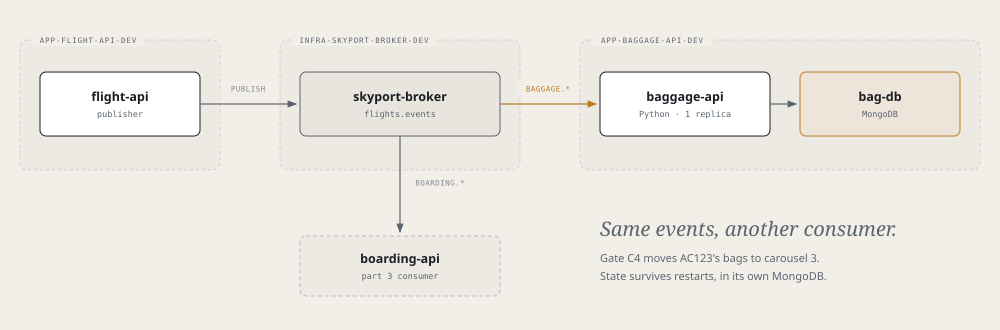

# Airframe quickstart 4: baggage-api and MongoDB

Add a third service on part 3's events: `baggage-api`, a Python service that moves a flight's bags to another
carousel when its gate changes. It is a second consumer on the broker, and it keeps its state in a MongoDB
database of its own.



> **Before you start**
> - Finish [part 3](quickstart-broker.md). The broker's `allowedNamespaces` must list `app-baggage-api-dev`.
> - The `MongoDB` XRD is on both clusters: `kubectl --context <dev-cluster> get xrd mongodbs.catalog.hangar.io` (and the same for `<prod-cluster>`).

## 1. Create the app

**Tower → Create → PythonApplication**

| Field | Value |
|---|---|
| Name | `baggage-api` |
| Dev cluster | `<dev-cluster>` |
| Description | Skyport baggage: re-routes bags when a gate changes |
| Python version | `3.13` |
| Package manager | `pip` |
| Port | `8080` |
| Visibility | `private` |

Merge the request PR, then both onboarding PRs.

> **Check**
> `kubectl --context <dev-cluster> get pythonapplication baggage-api -n app-baggage-api-cicd` shows `SYNCED True` and `READY True`.

## 2. Pull in the code

```bash
git clone https://github.com/<github-owner>/baggage-api.git && cd baggage-api
cp -R /tmp/airframe/examples/skyport/baggage-api/. .
./test.sh
```

The example's `Containerfile` replaces the scaffold's. It uses `python:3.13-alpine` and removes `pip` after
installing, because the Debian base and pip's vendored packages fail the image scan. Keep exactly one
container file in the repo, named `Containerfile`.

The app exits at start if `MONGODB_URI` is unset: there is no in-memory fallback.

| Endpoint | Purpose |
|---|---|
| `GET /api/bags` | Every flight seen: gate, carousel, bags, re-routes |
| `GET /api/bags/{flight}` | One flight |
| `GET /api/reroutes` | Recent re-routes, newest first |
| `GET /api/events/status` | Consumer state (`off`, `connecting`, `connected`) and messages received |

## 3. Ground: the database, the broker and the pipeline

```yaml title="glidepath/envs/dev.yaml"
envName: dev

rollout:
  replicas: 1      # replicas would compete for one queue, each seeing half the events

components:
  - type: rabbitmq
    name: bag-mq
    spec:
      mode: attach
      brokerRef: { name: skyport-broker, namespace: infra-skyport-broker-dev }
      vhost: flights
      queuePrefix: baggage
      consume: [flights.events]
  - type: mongodb
    name: bag-db
    spec: {}       # defaults: one member, 5Gi

env:
  - { name: RABBITMQ_HOST,     fromComponent: { name: bag-mq, output: host } }
  - { name: RABBITMQ_VHOST,    fromComponent: { name: bag-mq, output: vhost } }
  - { name: RABBITMQ_USER,     fromComponent: { name: bag-mq, output: username } }
  - { name: RABBITMQ_PASSWORD, fromComponent: { name: bag-mq, output: password } }
  - { name: MONGODB_URI,       fromComponent: { name: bag-db, output: uri } }
```

Check it before you push. `airframe-validate` rejects a component or output that doesn't exist:

```bash
/tmp/airframe/tools/airframe-validate glidepath/envs/dev.yaml
```

```yaml title="cicd.yaml"
apiVersion: platform/v1
kind: PipelineConfig

build:
  agent: python-3.13
  unitTest:
    enabled: true

deploy:
  strategy: rollout
  environments:
    - { name: dev, tier: ground }

governance:          # the gates the Containerfile is written to pass
  sast: true
  imageScan: true
  sbom: true

pipelines:
  ci:
    trigger: { source: git, event: push, branch: main }
    steps:
      - stage: build
      - stage: deploy
        env: dev
```

Commit both, push, and merge the `.tekton/` PR.

> **Check**
> ```bash
> kubectl --context <dev-cluster> get mongodbs.catalog.hangar.io,rabbitmqs.catalog.hangar.io -n app-baggage-api-dev
> /tmp/airframe/tools/airframe-verify mongodb app-baggage-api-dev/bag-db --context <dev-cluster>
> ```
> The `COMPONENT` column shows `MongoDBReady` and `RabbitMQAttachReady`. A replica set takes a few minutes; `MongoDBPending` means it is still converging.

## 4. See it work

```bash
kubectl --context <dev-cluster> port-forward -n app-flight-api-dev svc/flight-api 8081:8080 &
kubectl --context <dev-cluster> port-forward -n app-baggage-api-dev svc/baggage-api 8083:8080 &

curl -s localhost:8083/api/events/status     # "mode": "connected"
curl -s localhost:8083/api/bags/AC123        # gate and carousel

curl -s -X PUT -H 'Content-Type: application/json' -d '{"gate":"C4"}' localhost:8081/api/flights/AC123/gate

curl -s localhost:8083/api/bags/AC123        # carousel 3 now (A=1, B=2, C=3)
curl -s localhost:8083/api/reroutes          # the move
```

A flight appears only after its first event. Restart the pod: the bags and re-routes are still there, in `bag-db`.

If `mode` stays `connecting`, the bind is refused: `flight-api` hasn't declared the exchange yet, or the
namespace is missing from the broker's `allowedNamespaces`.

## 5. Flight: staging on the prod cluster

As in part 1, steps 6 to 9:

1. **Broker first:** the broker's staging values must list `app-baggage-api-staging` ([part 3, step 6](quickstart-broker.md)).
2. **`cicd.yaml`:** add the staging environment and a `release` stage. Merge the `.tekton/` PR.
3. **ApplicationEnvironment:** name `baggage-api-<prod-cluster>-staging`, namespace `app-baggage-api-cicd`, app `baggage-api`, cluster `<prod-cluster>`, env `staging`. Merge it.
4. **Values:** in a PR on `gitops-baggage-api`, give `<prod-cluster>/staging/values.yaml` the same `rollout`, `components` and `env` as dev, with `brokerRef.namespace: infra-skyport-broker-staging`.
5. **Release** a signed commit and merge the release PR.

> **Note**
> MongoDB 8.0 crashes at startup on Linux kernels 6.19 to 7.0.13. Check the prod node's kernel; in that range,
> set `spec: { mongoVersion: 7.0.14 }` on `bag-db`.
> ```bash
> kubectl --context <prod-cluster> get nodes -o jsonpath='{.items[*].status.nodeInfo.kernelVersion}'
> ```

## Remember

- MongoDB is a component, one replica set per environment. Read it with `fromComponent: { name: bag-db, output: uri }`.
- Run one replica of a queue consumer.
- Python images: alpine, then remove `pip`, or the image scan fails.
- `airframe-validate` your env file before you push.
- Use `mongodbs.catalog.hangar.io` in `kubectl`.

Next: [part 5, a shared token issuer](quickstart-skyport-auth.md).
