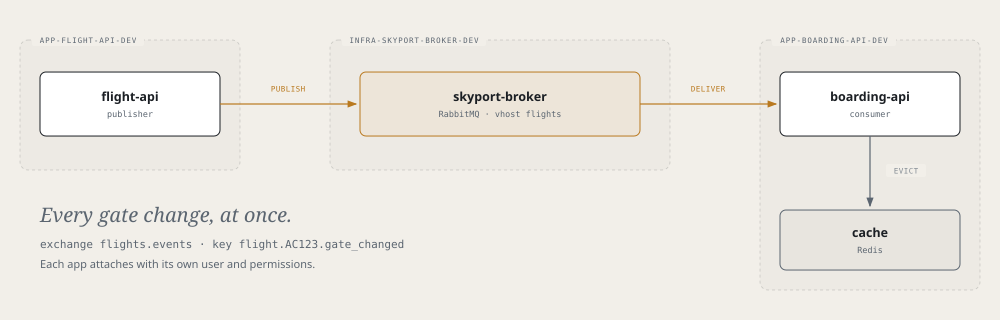

# Airframe quickstart 3: a shared message broker

Part 2 ended with a stale gate board: move a flight in `flight-api` and the board shows the old gate for up to
three minutes. This part fixes it. You provision `skyport-broker` (RabbitMQ) once, then attach `flight-api` as
a **publisher** and `boarding-api` as a **consumer**. Every gate change reaches the board at once.



> **Before you start**
> Finish [parts 1](quickstart.md) and [2](quickstart-flight-api.md).

## How the pieces fit

- **One broker, in its own namespace.** It is shared, so it can't live in any app's environment. It lives in an **InfraService**: a deploy repo with no source code. Its dev environment is `infra-skyport-broker-dev`.
- **One broker user per app**, created by an `attach` component in the app's environment. Its permissions come from a few names: `flight-api` may publish to the `flights.events` exchange; `boarding-api` may read from it into queues named `boarding.*`. The broker refuses anything else.
- **One vhost per domain** (`flights`). Apps that exchange messages share it.

## 1. Create the InfraService

**Tower → Create → InfraService**

| Field | Value |
|---|---|
| Name | `skyport-broker` |
| Namespace | `infra-skyport-broker-cicd` |
| Dev cluster | `<dev-cluster>` |
| Description | Skyport shared message broker (RabbitMQ) |
| Visibility | `private` |

Merge the PR.

> **Check**
> `kubectl --context <dev-cluster> get infraservice skyport-broker -n infra-skyport-broker-cicd` shows `SYNCED True` and `READY True`.

It creates one repo, `gitops-infra-skyport-broker`, with a README and a stub `cicd.yaml`. There is nothing to
build, so there is no pipeline.

## 2. Declare the broker

In `gitops-infra-skyport-broker`, create this file and push it to `main`:

```yaml title="glidepath/envs/dev.yaml"
appType: infra
envName: dev
rollout: { enabled: false }       # no workload of its own: the broker is the component

components:
  - type: rabbitmq
    name: skyport-broker          # also the Service: skyport-broker.infra-skyport-broker-dev.svc
    spec:
      mode: broker
      size: small
      instances: 1                # 3 for a replicated cluster
      storageSize: 1Gi
      vhosts: [flights]
      # Only these namespaces may attach and reach the AMQP port.
      allowedNamespaces: [app-flight-api-dev, app-boarding-api-dev, app-baggage-api-dev]
```

`allowedNamespaces` is the trust boundary: adding an app to the broker is one line here.
(`app-baggage-api-dev` is for [part 4](quickstart-baggage-api.md).)

> **Check**
> After two or three minutes, `kubectl --context <dev-cluster> get rabbitmqs.catalog.hangar.io -n infra-skyport-broker-dev`
> shows `READY True`. Use the full resource name: plain `rabbitmq` clashes with the operator's own kind.

## 3. Attach flight-api as the publisher

The publisher is already in the code you copied in part 2; it turns on with `EVENTS_ENABLED`. Add to
`flight-api`'s environment:

```yaml title="flight-api: glidepath/envs/dev.yaml"
components:
  # flight-db stays
  - type: rabbitmq
    name: flight-mq
    spec:
      mode: attach
      brokerRef: { name: skyport-broker, namespace: infra-skyport-broker-dev }
      vhost: flights
      publish: [flights.events]     # may declare and publish to this exchange, nothing else

env:
  # the DB_* entries stay
  - { name: EVENTS_ENABLED,    value: "true" }
  - { name: RABBITMQ_HOST,     fromComponent: { name: flight-mq, output: host } }
  - { name: RABBITMQ_VHOST,    fromComponent: { name: flight-mq, output: vhost } }
  - { name: RABBITMQ_USER,     fromComponent: { name: flight-mq, output: username } }
  - { name: RABBITMQ_PASSWORD, fromComponent: { name: flight-mq, output: password } }
```

`flight-api` publishes only after the database commit, and a broker outage never fails a flight change. Each
message carries the flight's new state, with a routing key like `flight.AC123.gate_changed`.

## 4. Attach boarding-api as the consumer

The consumer turns on when `RABBITMQ_HOST` is set:

```yaml title="boarding-api: glidepath/envs/dev.yaml"
components:
  # cache stays
  - type: rabbitmq
    name: board-mq
    spec:
      mode: attach
      brokerRef: { name: skyport-broker, namespace: infra-skyport-broker-dev }
      vhost: flights
      queuePrefix: boarding         # may create and read queues named boarding.*
      consume: [flights.events]     # may bind them to this exchange, not publish to it

env:
  # REDIS_* and FLIGHT_API_URL stay
  - { name: RABBITMQ_HOST,     fromComponent: { name: board-mq, output: host } }
  - { name: RABBITMQ_VHOST,    fromComponent: { name: board-mq, output: vhost } }
  - { name: RABBITMQ_USER,     fromComponent: { name: board-mq, output: username } }
  - { name: RABBITMQ_PASSWORD, fromComponent: { name: board-mq, output: password } }
```

`boarding-api` binds its queue `boarding.flight-events` to `flight.#` and drops each changed flight from the
Redis cache. Until `flight-api` has declared the exchange, the bind is refused and the consumer retries every
five seconds, so start order doesn't matter.

Push both files.

## 5. See it work

```bash
kubectl --context <dev-cluster> port-forward -n app-flight-api-dev svc/flight-api 8081:8080 &
kubectl --context <dev-cluster> port-forward -n app-boarding-api-dev svc/boarding-api 8080:8080 &

curl -s localhost:8080/api/whoami             # "events":"connected"
curl -s localhost:8080/api/boarding/AC123     # note the gate; ask again: "cached":true

curl -s -X PUT -H 'Content-Type: application/json' -d '{"gate":"B2"}' localhost:8081/api/flights/AC123/gate

curl -s localhost:8080/api/boarding/AC123     # B2 at once, "cached":false
```

`eventsReceived` in `/api/whoami` keeps climbing on its own: the simulator moves a flight every 30 seconds.

**What each app may do.** The broker enforces the names in each `attach` entry:

| Field | Allows | On |
|---|---|---|
| `publish: [flights.events]` | declare and publish | that exchange |
| `consume: [flights.events]` | bind queues, read only | that exchange |
| `queuePrefix: boarding` | create, bind and read queues | names starting `boarding.` |

So a leaked `boarding-api` credential can't forge a flight event, and one app can't read another's queue.

## 6. Flight: staging on the prod cluster

The broker needs about 1Gi of memory; check the prod cluster's headroom first.

1. **ApplicationEnvironment:** name `skyport-broker-<prod-cluster>-staging`, namespace `infra-skyport-broker-cicd`, app `skyport-broker`, cluster `<prod-cluster>`, env `staging`, **app type `infra`**. Merge it. The app type sends the values to `gitops-infra-skyport-broker`.
2. **Broker values:** in the PR on `gitops-infra-skyport-broker`, give `<prod-cluster>/staging/values.yaml` the same `rollout` and `components` as step 2, with `allowedNamespaces: [app-flight-api-staging, app-boarding-api-staging, app-baggage-api-staging]`. The broker comes up in `infra-skyport-broker-staging`.
3. **App values:** add each app's `attach` component and `env` entries from steps 3 and 4 to its staging values, with `brokerRef: { name: skyport-broker, namespace: infra-skyport-broker-staging }`.

No release is needed: the images already contain the code.

## Remember

- A shared broker is an InfraService with a `rabbitmq` component in `mode: broker`. Apps use `mode: attach`.
- InfraService XRs are in `infra-<name>-cicd` and its environments are `infra-<name>-<env>`.
- `allowedNamespaces` decides who may attach.
- Permissions come from `publish`, `consume` and `queuePrefix`, never hand-written patterns.
- Use `rabbitmqs.catalog.hangar.io` in `kubectl`.
- Deleting the broker's environment deletes its data.

Next: [part 4, baggage-api and MongoDB](quickstart-baggage-api.md).
