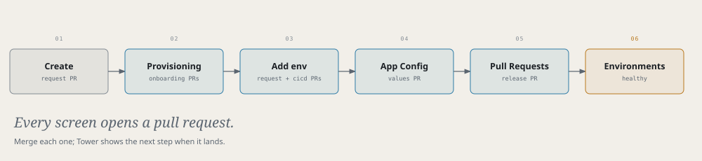

# Airframe quickstart 7: checkin-api through Tower

The same path as [part 6](quickstart-gate-api.md), for a small Python service, done in **Tower** instead of the
terminal: the create form, a staging environment, App Configuration and the release. This is the path
recorded as *checkin-api, in Tower* on [hangarplatform.dev/run](https://hangarplatform.dev/run/).



> **Before you start**
> Read [part 1](quickstart.md)'s rules, and sign in to Tower.

`checkin-api` says which check-in counters are open for a flight, and which version answered:

| Endpoint | Purpose |
|---|---|
| `GET /api/checkin/{flight}` | `AC123`, `WS456` or `PD789`: counters, opening time, bag drop |
| `GET /api/whoami` | `{version, pod}` |
| `GET /healthz` | Liveness and readiness |

## 1. Create

**Tower → Create → PythonApplication**

| Field | Value |
|---|---|
| Name | `checkin-api` |
| Dev cluster | `<dev-cluster>` |
| Description | Skyport check-in counters |
| Python version | `3.12` |
| Package manager | `pip` |
| Port | `8080` |
| Visibility | `private` |

Submit, then merge the request PR. The provisioning strip says *Merge the request PR to start provisioning*
until you do.

## 2. Follow provisioning

**Tower → Services → checkin-api → Provisioning** lists each step as it completes: the request applied, the dev
cluster checked, CI/CD onboarded, the repos, the catalog entry, the two onboarding PRs, the secret store, the
first build, and *Running healthy in dev*.

Merge both onboarding PRs when they appear. Then push the real code:

```bash
git clone https://github.com/<github-owner>/checkin-api.git && cd checkin-api
cp -R /tmp/airframe/examples/skyport/checkin-api/. .
```

The example's `Containerfile` (alpine, `pip` removed) replaces the scaffold's, which fails the image scan. In
`cicd.yaml`, set `build.unitTest.enabled: true`, or make the same change in Tower's **Glidepath** tab (it opens
a PR). Commit, push, and merge the `.tekton/` PR.

## 3. Add the staging environment

**Tower → checkin-api → Environments → Add environment**: tier **Flight**, name `staging`, cluster
`<prod-cluster>`. Leave `configMapGenerator` off.

This opens two PRs. **Merge the environment request first**, so the environment exists when `cicd.yaml` names it:

1. the `ApplicationEnvironment` request `checkin-api-<prod-cluster>-staging`, on the tenants repo;
2. the `cicd.yaml` change adding `{ name: staging, tier: flight, cluster: <prod-cluster> }`.

Then add a `release` stage for `staging` in the **Glidepath** tab's Pipelines section:

```yaml title="cicd.yaml"
      - stage: release
        env: staging
```

The environment's expanded row shows its provisioning: the request, Crossplane applying it, the values file,
the first deploy.

## 4. Configure staging

**Tower → checkin-api → App Configuration → staging.** Check the environment named at the top before you save.

| Section | Value |
|---|---|
| Deployment | On |
| Scaling | Replicas `4` |
| Service | Port name `http`, container port `8080` |
| Health checks | Liveness and readiness: HTTP GET `/healthz` on `8080` |
| Canary steps | setWeight 25, pause 45s, setWeight 50, pause 45s, setWeight 100 |

**Save** opens a PR on `gitops-checkin-api`. Read the diff, then merge it.

> **Note**
> A probe on a path the app doesn't serve crash-loops the pods, and Tower can still show the rollout as
> *Progressing*. If it sits there, look at the pods:
> `kubectl --context <prod-cluster> get pods -n app-checkin-api-staging`.

## 5. Release

Push a signed change to `main`. After build and deploy to dev, the `release` stage opens a PR on
`gitops-checkin-api`. Tower's **Pull Requests** tab lists it with its gates. Wait for them (`image-promotion`
runs last), then merge it.

## 6. Live on staging

**Tower → checkin-api → Environments**: `staging` shows Flight, the prod cluster, Healthy, and the live image.

> **Check**
> ```bash
> kubectl --context <prod-cluster> port-forward -n app-checkin-api-staging svc/checkin-api 18087:8080 &
> curl -s localhost:18087/api/checkin/AC123
> ```

## Remember

- Merge the request PR, then both onboarding PRs, then the `.tekton/` PR.
- **Add environment** opens two PRs: merge the environment request first.
- *Progressing* in Tower can hide a crash loop; check the pods.
- Sign every commit you release.
