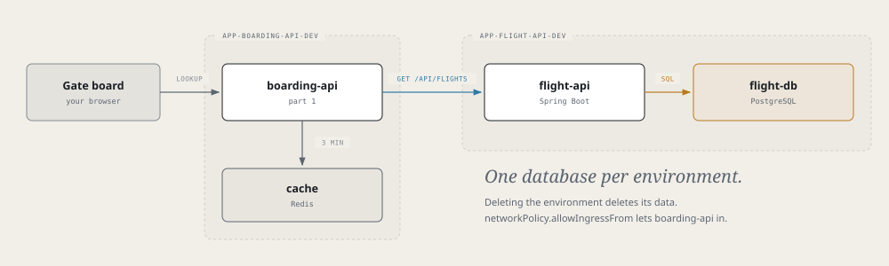

# Airframe quickstart 2: flight-api and a database

Build `flight-api`, Skyport's system of record: a Spring Boot service with its own PostgreSQL database,
24 flights and their gates, and a simulator that keeps moving them. Then point part 1's `boarding-api` at it,
so the gate board shows real data.



> **Before you start**
> Finish [part 1](quickstart.md). This part uses its rules and doesn't repeat them.

## 1. Create the app

**Tower → Create → SpringBootApplication**

| Field | Value |
|---|---|
| Name | `flight-api` |
| Dev cluster | `<dev-cluster>` |
| Description | Skyport system of record: flights and gates in Postgres |
| Java version | `21` |
| Build tool | `maven` |
| Group ID | `io.skyport.flight` (the code you copy in uses this package) |
| Port | `8080` |
| Visibility | `private` |

Merge the request PR, then both onboarding PRs.

> **Check**
> `kubectl --context <dev-cluster> get springbootapplication flight-api -n app-flight-api-cicd` shows `SYNCED True` and `READY True`.

## 2. Pull in the code

```bash
git clone https://github.com/<github-owner>/flight-api.git && cd flight-api
cp -R /tmp/airframe/examples/skyport/flight-api/. .
```

This replaces the scaffold's `Containerfile` too. `build.sh` compiles the jar once in the pipeline's Java
agent, and the new `Containerfile` only copies it into a JRE image. That keeps the two-architecture build
fast: compiling inside the image would run Maven twice, once under emulation.

`./test.sh` runs the unit tests without a database (it needs JDK 21 locally).

| Endpoint | Purpose |
|---|---|
| `GET /api/flights` | All 24 flights |
| `GET /api/flights/{flight}` | Gate, status, departure times, boarding group |
| `GET /api/flights/{flight}/events` | That flight's change log, newest first |
| `PUT /api/flights/{flight}/gate` | Move a flight to another gate |
| `GET /actuator/health/readiness` | Ready only when the database answers |

## 3. Ground: the database and the app

The database is a component, like part 1's Redis. Each environment gets its own PostgreSQL cluster in its own
namespace: deleting the environment deletes the data, and no other app can reach it.

```yaml title="glidepath/envs/dev.yaml"
envName: dev

components:
  - type: postgresql
    name: flight-db
    spec: { size: small, instances: 1, storageSize: 1Gi }

env:
  - { name: DB_HOST,     fromComponent: { name: flight-db, output: host } }
  - { name: DB_PORT,     fromComponent: { name: flight-db, output: port } }
  - { name: DB_NAME,     fromComponent: { name: flight-db, output: database } }
  - { name: DB_USER,     fromComponent: { name: flight-db, output: username } }
  - { name: DB_PASSWORD, fromComponent: { name: flight-db, output: password } }

rollout:
  resources:
    requests: { cpu: 500m, memory: 512Mi }   # the JVM starts CPU-bound
    limits: { memory: 1Gi }                  # no CPU limit, or startup is throttled
  readinessProbe:
    httpGet: { path: /actuator/health/readiness, port: 8080 }
    initialDelaySeconds: 30
    timeoutSeconds: 5
    failureThreshold: 6
  livenessProbe:
    httpGet: { path: /actuator/health/liveness, port: 8080 }
    initialDelaySeconds: 60
    timeoutSeconds: 5
    failureThreshold: 6

networkPolicy:
  allowIngressFrom:          # namespaces deny each other by default
    - { namespace: app-boarding-api-dev, ports: [8080] }
```

> **Note**
> Point liveness at `/liveness`, never `/readiness`. Readiness includes the database, so a short database
> stall would make Kubernetes kill a healthy pod.

Switch the pipeline to compile in the agent:

```yaml title="cicd.yaml"
apiVersion: platform/v1
kind: PipelineConfig

build:
  agent: openjdk-21
  script: ./build.sh               # compile in the agent...
  containerfile: ./Containerfile   # ...then just package the jar
  unitTest:
    enabled: true

deploy:
  strategy: rollout
  environments:
    - { name: dev, tier: ground }

pipelines:
  ci:
    trigger: { source: git, event: push, branch: main }
    steps:
      - stage: build
      - stage: deploy
        env: dev
```

Commit both files, push, and merge the `.tekton/` PR. The database comes up first; the app follows once the
deploy stage sets its image. The first start takes a minute or two while Flyway runs the migrations.

> **Check**
> ```bash
> kubectl --context <dev-cluster> get postgresql,pods -n app-flight-api-dev
> kubectl --context <dev-cluster> port-forward -n app-flight-api-dev svc/flight-api 8081:8080
> curl -s localhost:8081/api/flights/AC123
> ```
> The simulator writes an event about every 30 seconds; `curl -s localhost:8081/api/flights/AC123/events` grows.

## 4. Point boarding-api at it

Add one variable to `boarding-api`'s `glidepath/envs/dev.yaml`, under `env:`, and push:

```yaml
  - { name: FLIGHT_API_URL, value: "http://flight-api.app-flight-api-dev.svc.cluster.local:8080" }
```

Look up `AC123` on the gate board. The **source** row now says *flight-api (Postgres)*, with a live **status**.

Now move the flight's gate:

```bash
curl -s -X PUT -H 'Content-Type: application/json' -d '{"gate":"B2"}' localhost:8081/api/flights/AC123/gate
```

The gate board still shows the old gate until its three-minute cache expires. [Part 3](quickstart-broker.md)
fixes that with a message broker.

## 5. Flight: staging on the prod cluster

This works as in part 1, steps 6 to 9. Only what differs is here.

1. **`cicd.yaml`:** add `{ name: staging, tier: flight, cluster: <prod-cluster> }` and a `release` stage for `staging`. Merge the `.tekton/` PR.
2. **ApplicationEnvironment:** name `flight-api-<prod-cluster>-staging`, namespace `app-flight-api-cicd`, app `flight-api`, cluster `<prod-cluster>`, env `staging`. Merge it. The database comes up in `app-flight-api-staging` before the app does.
3. **Values:** in a PR on `gitops-flight-api`, add to `<prod-cluster>/staging/values.yaml` (keep the identity keys Crossplane wrote):

   ```yaml title="gitops-flight-api/<prod-cluster>/staging/values.yaml"
   rollout:
     replicas: 2
     ports: [{ name: http, containerPort: 8080 }]
     # resources, readinessProbe and livenessProbe: the same as dev

   components:
     - type: postgresql
       name: flight-db
       spec: { size: small, instances: 2, storageSize: 5Gi }   # a primary and a replica

   env:
     # the same five DB_* entries as dev

   networkPolicy:
     allowIngressFrom:
       - { namespace: app-boarding-api-staging, ports: [8080] }
   ```

   Edit this file in the PR directly and read the diff before merging: `fromComponent` entries are easier to
   check there than in App Configuration.
4. **Release** a signed commit and merge the release PR.
5. **Connect boarding-api:** in `boarding-api`'s staging values, set `FLIGHT_API_URL` to `http://flight-api.app-flight-api-staging.svc.cluster.local:8080`.

> **Check**
> ```bash
> kubectl --context <prod-cluster> get all,pvc -n app-flight-api-staging -l hangar.io/app=flight-api
> ```

## Remember

- A database is a component under `components:`, not a Tower form. Read its outputs with `fromComponent` (`host`, `port`, `database`, `username`, `password`, `uri`, `jdbcUri`).
- Deleting an environment deletes its database and volumes.
- Build Java with `build.script`, not inside the `Containerfile`.
- Liveness on `/actuator/health/liveness`; give the pod a CPU request and no CPU limit.
- Cross-namespace traffic needs `networkPolicy.allowIngressFrom`.
- `-l hangar.io/app=<app>` finds everything an app owns.

Next: [part 3, a shared message broker](quickstart-broker.md).
