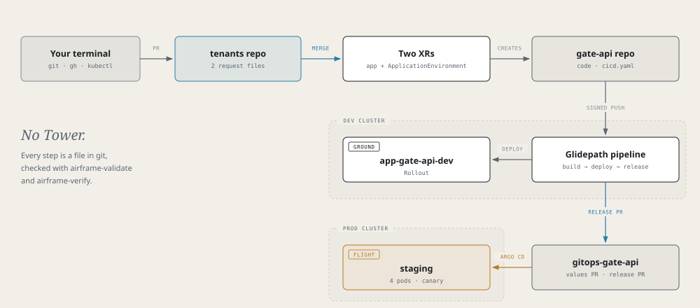

# Airframe quickstart 6: gate-api from the terminal

Take the smallest Skyport service from a request file to a canary on the prod cluster without opening Tower.
Every step is a file in git or a `kubectl` or `gh` command. This is the path recorded as *gate-api, in the
terminal* on [hangarplatform.dev/run](https://hangarplatform.dev/run/).



> **Before you start**
> - Read [part 1](quickstart.md)'s rules; parts 2 to 5 are not needed.
> - Clone the dev cluster's tenants repo (its `tenantsRepo` in `clusters.yaml`).
> - Configure git to sign with gitsign: `git config gpg.x509.program gitsign`, `git config gpg.format x509`, `git config commit.gpgsign true`.

`gate-api` answers "what's at this gate?" and says which version and pod answered:

| Endpoint | Purpose |
|---|---|
| `GET /api/gates/{gate}` | `A12`, `A14`, `B3` or `C7`; 404 for any other |
| `GET /api/whoami` | `{version, pod}` |
| `GET /healthz` | Liveness and readiness |

## 1. Request the app

Write the request yourself, in a branch of the tenants repo:

```yaml title="tenants/gate-api/xr-requests/gate-api.yaml"
apiVersion: catalog.hangar.io/v1alpha1
kind: NodeJSApplication
metadata:
  name: gate-api
  namespace: app-gate-api-cicd
spec:
  devCluster: <dev-cluster>
  description: 'Skyport gate display: which flight is at which gate'
  nodeVersion: '20'
  packageManager: npm
  port: 8080
  visibility: private
```

Validate it against the XRD, then open a PR and merge it:

```bash
/tmp/airframe/tools/airframe-validate --xr tenants/gate-api/xr-requests/gate-api.yaml
```

## 2. Watch it compose, then merge the onboarding PRs

```bash
/tmp/airframe/tools/airframe-verify nodejsapplication app-gate-api-cicd/gate-api --context <dev-cluster>
gh pr list -R <github-owner>/gate-api
gh pr list -R <github-owner>/gitops-gate-api
```

`airframe-verify` checks `DevClusterReady`, `CicdOnboarded` and that both repos exist. Merge the onboarding PR on each repo.

## 3. Add the code and the pipeline

```bash
git clone https://github.com/<github-owner>/gate-api.git && cd gate-api
cp -R /tmp/airframe/examples/skyport/gate-api/. .
npm test
```

The example's `Containerfile` replaces the scaffold's. Then set up the whole pipeline at once:

```yaml title="cicd.yaml"
apiVersion: platform/v1
kind: PipelineConfig

build:
  agent: nodejs-20
  unitTest:
    enabled: true

deploy:
  strategy: rollout
  environments:
    - { name: dev,     tier: ground }
    - { name: staging, tier: flight, cluster: <prod-cluster> }

pipelines:
  ci:
    trigger: { source: git, event: push, branch: main }
    steps:
      - stage: build
      - stage: deploy
        env: dev
      - stage: release
        env: staging
```

Commit (signed), push, and merge the `.tekton/` PR.

## 4. Request staging

Back in the tenants repo:

```yaml title="tenants/gate-api/xr-requests/gate-api-<prod-cluster>-staging.yaml"
apiVersion: catalog.hangar.io/v1alpha1
kind: ApplicationEnvironment
metadata:
  name: gate-api-<prod-cluster>-staging
  namespace: app-gate-api-cicd
spec:
  appName: gate-api
  cluster: <prod-cluster>
  env: staging
  configMapGenerator: false
```

Validate with `airframe-validate --xr`, merge, then:

```bash
/tmp/airframe/tools/airframe-verify applicationenvironment app-gate-api-cicd/gate-api-<prod-cluster>-staging --context <dev-cluster>
```

## 5. Ground: see it on dev

The push after the `.tekton/` merge builds the image and deploys it to dev.

```bash
kubectl --context <dev-cluster> get pipelineruns -n app-gate-api-cicd
kubectl --context <dev-cluster> get rollout gate-api -n app-gate-api-dev
kubectl --context <dev-cluster> port-forward -n app-gate-api-dev svc/gate-api 18086:8080 &
curl -s localhost:18086/api/whoami
```

## 6. Flight: staging values

In a PR on `gitops-gate-api`, add to the values Crossplane wrote (keep `appName`, `appType`, `cluster`, `envName`):

```yaml title="gitops-gate-api/<prod-cluster>/staging/values.yaml"
rollout:
  replicas: 4                  # four pods give readable 25% canary steps
  ports:
    - { name: http, containerPort: 8080 }
  resources:
    requests: { cpu: 50m, memory: 64Mi }
    limits: { memory: 128Mi }
  steps:                       # 25%, wait 45 s, 50%, wait 45 s, 100%
    - setWeight: 25
    - pause: { duration: 45s }
    - setWeight: 50
    - pause: { duration: 45s }
    - setWeight: 100
  livenessProbe:
    httpGet: { path: /healthz, port: 8080 }
  readinessProbe:
    httpGet: { path: /healthz, port: 8080 }
```

Validate it from the `gitops-gate-api` checkout with `/tmp/airframe/tools/airframe-validate <prod-cluster>/staging/values.yaml`, then merge.

## 7. Flight: release

Push a signed change to `main`. After build and deploy to dev, the `release` stage opens a PR on
`gitops-gate-api` that writes `<prod-cluster>/staging/release.yaml` and a release record. Wait for the gates (`sast`, `image-scan`, `sbom`,
`values`, `provenance`, then `image-promotion`), then merge it:

```bash
gh pr list -R <github-owner>/gitops-gate-api
gh pr checks <number> -R <github-owner>/gitops-gate-api
gh pr merge <number> -R <github-owner>/gitops-gate-api
```

The prod cluster's Argo CD syncs it.

## 8. Watch a canary

Bump `"version"` in `package.json`, commit (signed) and push. Merge the new release PR, then watch the steps:

```bash
kubectl --context <prod-cluster> argo rollouts get rollout gate-api -n app-gate-api-staging --watch
```

Tower's Deployments tab shows the same canary.

## Remember

- Two request files make an app with a flight environment: the app XR and an `ApplicationEnvironment`.
- `airframe-validate --xr` checks a request before you push; `airframe-verify <kind> <ns>/<name>` checks it once applied.
- Sign every commit you release.
- A canary splits by pod count: one replica can't show 25%.

Next: [part 7, checkin-api through Tower](quickstart-checkin-api.md).
