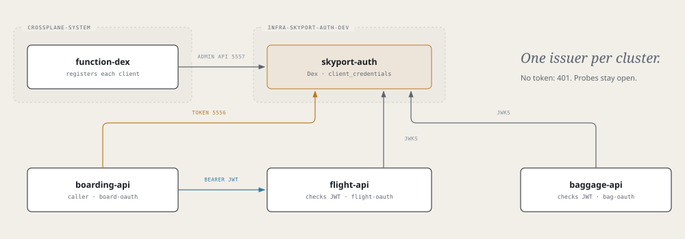

# Airframe quickstart 5: a shared token issuer

Give Skyport one token issuer, `skyport-auth` (Dex), and make the APIs require its tokens. `flight-api` and
`baggage-api` refuse calls without a valid JWT; `boarding-api` mints a token and sends it when it calls
`flight-api`.



> **Before you start**
> - Finish [parts 1 to 4](quickstart.md).
> - `function-dex` and the `Dex` XRD are on both clusters:
>   ```bash
>   for ctx in <dev-cluster> <prod-cluster>; do
>     kubectl --context $ctx get function function-dex
>     kubectl --context $ctx get xrd dexes.catalog.hangar.io
>   done
>   ```

## How the pieces fit

- **One Dex server per environment**, in an InfraService, like the broker. Port 5556 serves tokens and keys to the namespaces in `allowedNamespaces`; port 5557 (the admin API) is open only to Crossplane.
- **One OAuth client per app**, created by an `attach` component. A caller needs `tokenUrl`, `clientId` and `clientSecret`; an API that checks tokens needs `issuer` and `jwksUrl`.
- **Service-to-service only.** The one grant is `client_credentials`: no browser, no login page. Any valid token from this server is accepted; there are no per-client scopes.
- **Off until configured.** The code is already in the images. An API enforces tokens once `OAUTH_JWKS_URL` is set; probes and `/api/whoami` stay open.

## 1. Create the InfraService

**Tower → Create → InfraService**

| Field | Value |
|---|---|
| Name | `skyport-auth` |
| Namespace | `infra-skyport-auth-cicd` |
| Dev cluster | `<dev-cluster>` |
| Description | Skyport shared OIDC provider (Dex) |
| Visibility | `private` |

Merge the PR. It creates `gitops-infra-skyport-auth`.

## 2. Declare the server

In `gitops-infra-skyport-auth`, create this file and push it to `main`:

```yaml title="glidepath/envs/dev.yaml"
appType: infra
envName: dev
rollout: { enabled: false }       # no workload of its own: Dex is the component

components:
  - type: dex
    name: skyport-auth            # also the Service: skyport-auth.infra-skyport-auth-dev.svc
    spec:
      mode: server
      size: small
      storageSize: 1Gi
      # Namespaces that may reach the token and key endpoints (5556).
      allowedNamespaces: [app-flight-api-dev, app-baggage-api-dev, app-boarding-api-dev]
```

> **Check**
> ```bash
> kubectl --context <dev-cluster> get dexes.catalog.hangar.io -n infra-skyport-auth-dev        # DexServerReady
> /tmp/airframe/tools/airframe-verify dex infra-skyport-auth-dev/skyport-auth --context <dev-cluster>
> ```

## 3. Attach a client to each app

Add one `dex` component in `mode: attach` to each app's `glidepath/envs/dev.yaml`.

**`flight-api` and `baggage-api`** check tokens (use `name: bag-oauth` for `baggage-api`):

```yaml title="flight-api: glidepath/envs/dev.yaml"
components:
  # existing components stay
  - type: dex
    name: flight-oauth
    spec:
      mode: attach
      serverRef: { name: skyport-auth, namespace: infra-skyport-auth-dev }

env:
  # existing entries stay
  - { name: OAUTH_ISSUER,   fromComponent: { name: flight-oauth, output: issuer } }
  - { name: OAUTH_JWKS_URL, fromComponent: { name: flight-oauth, output: jwksUrl } }
```

**`boarding-api`** calls `flight-api`, so it gets the client credentials:

```yaml title="boarding-api: glidepath/envs/dev.yaml"
components:
  # existing components stay
  - type: dex
    name: board-oauth
    spec:
      mode: attach
      serverRef: { name: skyport-auth, namespace: infra-skyport-auth-dev }

env:
  # existing entries stay
  - { name: OAUTH_TOKEN_URL,     fromComponent: { name: board-oauth, output: tokenUrl } }
  - { name: OAUTH_CLIENT_ID,     fromComponent: { name: board-oauth, output: clientId } }
  - { name: OAUTH_CLIENT_SECRET, fromComponent: { name: board-oauth, output: clientSecret } }
```

> **Note**
> Push `boarding-api` first. Once `flight-api` enforces, a `boarding-api` without a token gets `401` and the gate
> board answers `502` until it has one.

`boarding-api` caches its token until 30 seconds before it expires, and drops it on a `401`.

> **Check**
> `kubectl --context <dev-cluster> get dexes.catalog.hangar.io -A` shows `DexAttachReady` for each client.
> `DexAttachFailed` means the admin API call failed: check that the server is ready.

## 4. Check it: 401 without a token, 200 with one

`docs/walkthroughs/lib/dex.sh` mints a token with `boarding-api`'s client, without printing it:

```bash
. /tmp/airframe/docs/walkthroughs/lib/dex.sh
tok="$(dex_token <dev-cluster> app-boarding-api-dev board-oauth)"
expect_enforced <dev-cluster> app-flight-api-dev flight-api 8080 /api/flights/AC123 "$tok"
expect_enforced <dev-cluster> app-baggage-api-dev baggage-api 8080 /api/bags "$tok"
```

Each prints `without a token 401, with a token 200`. Then the real caller:

```bash
kubectl --context <dev-cluster> port-forward -n app-boarding-api-dev svc/boarding-api 8080:8080 &
curl -s localhost:8080/api/boarding/AC123     # 200, "source": "flight-api"
```

That answer proves the whole path inside the cluster: `boarding-api` reached Dex, and `flight-api` fetched its keys.

From now on, calling `flight-api` or `baggage-api` by hand needs `-H "Authorization: Bearer $tok"`.

## 5. Flight: staging on the prod cluster

The prod cluster gets its own Dex server. Tokens from the dev server are not valid there.

1. **ApplicationEnvironment:** name `skyport-auth-<prod-cluster>-staging`, namespace `infra-skyport-auth-cicd`, app `skyport-auth`, cluster `<prod-cluster>`, env `staging`, **app type `infra`**. Merge it.
2. **Server values:** in the PR on `gitops-infra-skyport-auth`, give `<prod-cluster>/staging/values.yaml` the same `rollout` and `components` as step 2, with `allowedNamespaces: [app-flight-api-staging, app-baggage-api-staging, app-boarding-api-staging]`. Dex comes up in `infra-skyport-auth-staging`.
3. **App values:** add each app's attach component and `env` entries from step 3 to its staging values, with `serverRef: { name: skyport-auth, namespace: infra-skyport-auth-staging }`.

> **Check**
> ```bash
> tok="$(dex_token <prod-cluster> app-boarding-api-staging board-oauth)"
> expect_enforced <prod-cluster> app-flight-api-staging flight-api 8080 /api/flights/AC123 "$tok"
> ```

## Remember

- Dex is a component: `mode: server` in an InfraService, `mode: attach` in each app.
- APIs need `issuer` and `jwksUrl`; callers need `tokenUrl`, `clientId` and `clientSecret`.
- `allowedNamespaces` on the server opens port 5556 to an app.
- `OAUTH_JWKS_URL` set means enforcing.
- One server per environment; tokens don't cross clusters.
- Deleting an attach component leaves its client on the server; recreating it adopts the existing one.

Next: [part 6, gate-api from the terminal](quickstart-gate-api.md).
