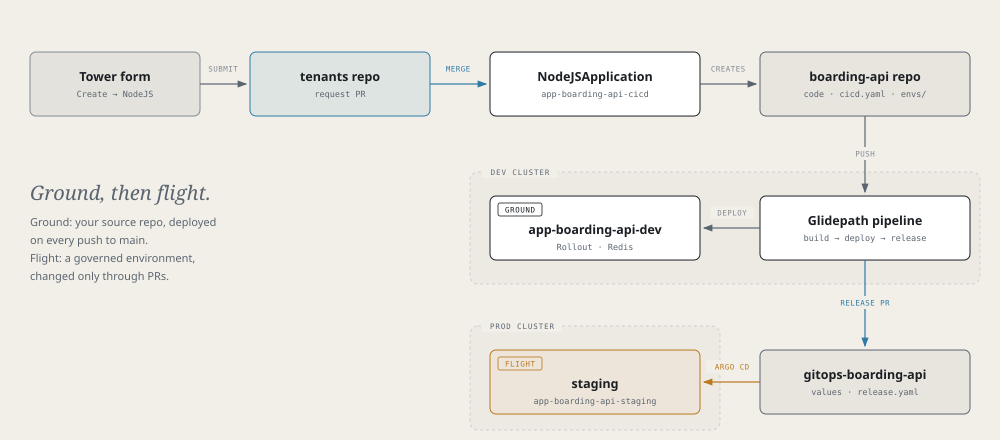

# Airframe quickstart 1: boarding-api

Build `boarding-api`, the gate board of [Skyport](skyport-demo.md): a small NodeJS service that looks up a
flight's gate and caches the answer in Redis. You will create it, deploy it to a **ground** environment on
the dev cluster, give it a Redis cache, promote it to a **flight** environment on the prod cluster, and
watch a canary roll out.



> **Before you start**
> - Tower is up and you are signed in.
> - [gitsign](https://github.com/jfillman/glidepath/blob/main/docs/admin/commit-signing.md#developer-setup) is set up, and a platform admin has added your signing identity to the release-signing policy.
> - Nothing is left over from an earlier run. The [Skyport runbook](skyport-runbook.md#before-you-start-leftovers-from-a-previous-run) lists what to clean up.

## The rules every part uses

**Placeholders.** `<dev-cluster>` and `<prod-cluster>` are the clusters' names in the fleet's
`clusters.yaml`, which are also their `kubectl` contexts (for example `hangar-dev` and `hangar-prod`).
`<github-owner>` owns the app repos.

**Where things live.**

| | Application | InfraService |
|---|---|---|
| XRs (the app, its environments) | `app-<name>-cicd` | `infra-<name>-cicd` |
| An environment's namespace | `app-<name>-<env>` | `infra-<name>-<env>` |
| Deploy repo | `gitops-<name>` | `gitops-infra-<name>` |

**Four habits.**

1. **Merge the `.tekton/` PR.** Glidepath opens one after onboarding and after every `cicd.yaml` change. No merge, no pipeline.
2. **`git pull` after the pipeline runs.** The deploy stage commits the image to `glidepath/envs/<env>.release.yaml` on `main`.
3. **Leave `build.platforms` unset.** The dev cluster is arm64 and the prod cluster amd64; the image is built for both.
4. **Release signed commits.** The release's `provenance` gate checks the app commit it promotes. Push a gitsign-signed commit to `main` (or fast-forward one). GitHub's merge button works only when a platform admin has turned on the GitHub-merge path for the app.

## 1. Create the app

**Tower → Create → NodeJSApplication**

| Field | Value |
|---|---|
| Name | `boarding-api` |
| Dev cluster | `<dev-cluster>` |
| Description | Skyport gate board |
| Node version | `20` |
| Package manager | `npm` |
| Port | `8080` |
| Visibility | `private` |

The dev cluster must be its exact registry name. Any other value gives the app a secret store nothing reads,
and its pods stay in `CreateContainerConfigError`.

Submitting opens a PR on the dev cluster's tenants repo. **Merge it.**

> **Check**
> `kubectl --context <dev-cluster> get nodejsapplication boarding-api -n app-boarding-api-cicd` shows `SYNCED True` and `READY True`.

Crossplane creates two repos: `boarding-api` (a hello-world app, `Containerfile` and starter `cicd.yaml`)
and `gitops-boarding-api`.

## 2. Merge the onboarding PRs

Glidepath opens one PR on each repo. They add the generated `.tekton/` pipelines and
`glidepath/envs/dev.yaml`. **Merge both**, from GitHub or Tower's **Pull Requests** tab.

Merging the source repo's PR starts the first build, which deploys the hello-world app to `dev`.

> **Note**
> Pipelines on pull requests run only after you add the `preview` label to the PR.

## 3. Pull in the code

The real `boarding-api` lives in this repo under `examples/skyport/boarding-api/`. Copy it over the scaffold:

```bash
git clone https://github.com/jfillman/airframe.git /tmp/airframe
git clone https://github.com/<github-owner>/boarding-api.git && cd boarding-api
cp -R /tmp/airframe/examples/skyport/boarding-api/. .
```

Keep the scaffolded `Containerfile`. Try it locally:

```bash
npm install && npm test
PORT=8080 node index.js        # open http://localhost:8080
```

The header says `cache: memory`: with no Redis configured, the app keeps its cache in the process.

The example code already contains everything later parts switch on (the flight-api client, the broker
consumer, the token client). Each piece stays off until its environment variable is set.

| Endpoint | Purpose |
|---|---|
| `GET /` | The gate board: flight lookup, boarding-pass scans, version tally |
| `GET /api/boarding/{flight}` | Boarding info for a flight such as `AC123`, cached for 3 minutes |
| `POST /api/boarding/{flight}/scan` | Count one boarding pass |
| `GET /api/whoami` | Version, pod and cache mode |
| `GET /healthz` | Liveness and readiness |

## 4. Ground: deploy to dev

Onboarding already wrote a `cicd.yaml` that builds and deploys to `dev`. Turn on the unit tests, since the
code you copied has a `test.sh`:

```yaml title="cicd.yaml"
apiVersion: platform/v1
kind: PipelineConfig

build:
  agent: nodejs-20
  unitTest:
    enabled: true          # runs ./test.sh

deploy:
  strategy: rollout
  environments:            # every environment once, in promotion order
    - { name: dev, tier: ground }

pipelines:
  ci:
    trigger: { source: git, event: push, branch: main }
    steps:
      - stage: build
      - stage: deploy
        env: dev
```

Commit, push, and merge the `.tekton/` PR the change opens. The pipeline builds the image and the deploy
stage commits it to `glidepath/envs/dev.release.yaml`. Pull before your next push.

> **Check**
> ```bash
> kubectl --context <dev-cluster> get pods -n app-boarding-api-dev
> kubectl --context <dev-cluster> port-forward -n app-boarding-api-dev svc/boarding-api 8080:8080
> ```
> Open <http://localhost:8080> and look up `AC123` twice: the second answer is a cache hit. Press
> **Scan a boarding pass** a few times. The count jumps around because each of the two pods keeps its own.

## 5. Ground: add a Redis cache

Redis is a **component**: an entry under `components:` in an environment's values. The chart turns it into a
`Redis` XR in the app's namespace. `fromComponent` hands its connection details to the app.

```yaml title="glidepath/envs/dev.yaml"
envName: dev

components:
  - type: redis
    name: cache
    spec: { size: small, persistence: false }

env:
  - { name: REDIS_URL,      fromComponent: { name: cache, output: url } }
  - { name: REDIS_PASSWORD, fromComponent: { name: cache, output: password } }
```

Push it. No build runs; Argo CD applies the change and the pods restart.

> **Check**
> The gate board header says `cache: redis`, and each scan adds exactly one, whichever pod answers.

> **Note**
> The `Redis` XR reports `Ready=False` for about ten minutes after a change, though the pods are fine.
> Check the pods instead of waiting on the XR.

## 6. Flight: declare staging

Add the flight environment and a `release` stage to `cicd.yaml`:

```yaml title="cicd.yaml"
deploy:
  strategy: rollout
  environments:
    - { name: dev,     tier: ground }
    - { name: staging, tier: flight, cluster: <prod-cluster> }

pipelines:
  ci:
    trigger: { source: git, event: push, branch: main }
    steps:
      - stage: build
      - stage: deploy
        env: dev
      - stage: release
        env: staging
```

Commit, push, and merge the `.tekton/` PR.

## 7. Flight: create the environment

**Tower → Create → ApplicationEnvironment**

| Field | Value |
|---|---|
| Name | `boarding-api-<prod-cluster>-staging` |
| Namespace | `app-boarding-api-cicd` |
| Owner | your Backstage group, e.g. `group:default/<your-team>` |
| App name | `boarding-api` |
| Cluster | `<prod-cluster>` (must be an upper cluster; a dev cluster is rejected) |
| Env | `staging` |
| configMapGenerator | off |

Merge the PR it opens. Crossplane writes a starter `values.yaml` to `gitops-boarding-api/<prod-cluster>/staging/`,
and the prod cluster's own Argo CD creates the empty namespace `app-boarding-api-staging`.

> **Check**
> `kubectl --context <dev-cluster> describe applicationenvironment boarding-api-<prod-cluster>-staging -n app-boarding-api-cicd`
> shows `ClusterReady: True` and `AppResolved: True`.

> **Tip**
> **Tower → boarding-api → Environments → Add environment** does steps 6 and 7 in one go. It opens both PRs; merge the environment request first. Part 7 uses it.

## 8. Flight: configure staging

**Tower → boarding-api → App Configuration → staging.** Check the environment named at the top before you save.

| Section | Value |
|---|---|
| Deployment | On |
| Scaling | Replicas `4` (a canary splits by pod count, so 4 gives 25% steps) |
| Resources | Requests `100m` / `128Mi`, limits `500m` / `256Mi` |
| Service | Port name `http`, container port `8080` |
| Health checks | Liveness and readiness: HTTP GET `/healthz` on `8080` |
| Canary steps | Keep the default |

**Save** opens a PR on `gitops-boarding-api`, checked against the chart's schema. Merge it. There is no image
field: the release sets the image.

## 9. Flight: release

Push a signed commit to `main`. After build and deploy to dev, the `release` stage opens a PR on
`gitops-boarding-api` that writes `<prod-cluster>/staging/release.yaml`. Wait for its gates
(`image-promotion` runs last), then merge it.

> **Check**
> `kubectl --context <prod-cluster> get rollout boarding-api -n app-boarding-api-staging` is `Healthy`, or look in Tower.

## 10. Watch a canary

The gate board polls `/api/whoami` twice a second and draws a bar of which version answered.

1. Port-forward to staging and open the board: one bar, 100% of the current version.
   ```bash
   kubectl --context <prod-cluster> port-forward -n app-boarding-api-staging svc/boarding-api 8080:8080
   ```
2. Bump `"version"` in `package.json` (to `2.0.0`, say), commit signed, push, and merge the new release PR.
3. Watch the steps. With four replicas the bar moves from a quarter of the new version, to half, to all of it.
   ```bash
   kubectl --context <prod-cluster> argo rollouts get rollout boarding-api -n app-boarding-api-staging --watch
   kubectl --context <prod-cluster> argo rollouts promote boarding-api -n app-boarding-api-staging   # if a step is paused
   ```

Press **Reset tally** between steps to see the current mix. The split is by pod count, because the chart has
no traffic router.

- **Blue/green instead:** set `rollout.strategy: blueGreen`. Port-forward to `boarding-api-preview` to see the new version before promotion.
- **Roll back:** abort the rollout, or revert the release PR.

## Remember

- Merge the `.tekton/` PR after onboarding and after every `cicd.yaml` change.
- Ground environments live in your source repo (`glidepath/envs/<env>.yaml`); flight environments need an `ApplicationEnvironment` and change only through PRs on `gitops-<app>`.
- App Configuration lists only the flight environments `cicd.yaml` declares.
- Components (`redis`, `postgresql`, `rabbitmq`, `mongodb`, `dex`) go under `components:`; read their outputs with `fromComponent`.
- Name the environment with `envName`, never `env` (that is the container env-var list).
- Use four replicas to see a canary's steps.

Next: [part 2, flight-api and a database](quickstart-flight-api.md).
